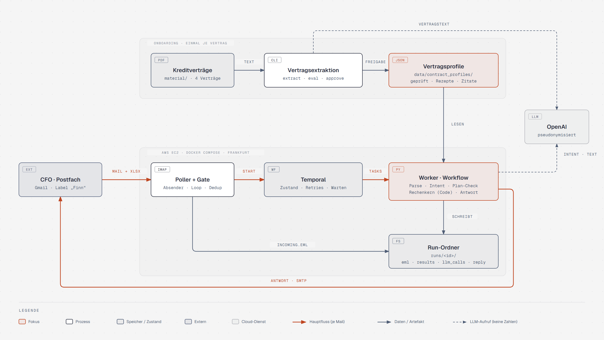

# Finn – Covenant-Prüfung per E-Mail

Finn ist ein digitaler Referent Finanzierung. Die Finanzleitung schickt Finn den Wirtschaftsplan (`.xlsx`) per Mail; Finn prüft alle Financial Covenants der vier Kreditverträge auf Planbasis und antwortet im selben Thread mit Ergebnis, Spielraum und der Quelle jeder Zahl (Vertragsstelle + Excel-Zelle).

**Grundregel:** Das Sprachmodell liest, strukturiert und formuliert – gerechnet wird ausschließlich im Code.



## So arbeitet Finn

1. **Einmal je Vertrag (Onboarding):** Die Vertrags-PDFs werden per LLM in **Vertragsprofile** übersetzt (Kennzahl, Definition als „Rezept“, Schwelle, Rundung, wörtliche Zitate mit Seite). Jedes Zitat wird gegen das PDF geprüft, ein Schlagwort-Scan sucht Lücken, ein Abgleich mit handgeschriebenen Referenzprofilen ergibt 95/95. Erst nach Freigabe nutzt Finn ein Profil.
2. **Je Mail (Laufzeit):** Poller holt die Mail (nur Gmail-Label „Finn“), das Gate prüft Absender und Schleifen, Temporal startet den Workflow. Der Worker liest den Plan labelbasiert (nicht über feste Zellen), prüft ihn (Bilanz ausgeglichen, Planjahr, Einheiten …), rechnet jede Kennzahl nach der Definition *des jeweiligen Vertrags* und antwortet.
3. **Nachvollziehbarkeit:** Jeder Lauf schreibt einen Run-Ordner (`runs/<id>/`: Mail, Planwerte, Prüfungen, Ergebnisse, pseudonymisierte LLM-Aufrufe, Antwort). Temporal zeigt jeden Schritt mit Retries.

Ergebnis für `material/Wirtschaftsplan_2027.xlsx`: alle Covenants eingehalten – Förderbank 34,32 % (≥ 27,5 %), Landesbank DSCR 1,56 (≥ 1,30), Konsortialkredit EK-Quote 30,7 % (≥ 30,0 %, knapp) und Verschuldungsgrad 3,37 (≤ 3,50, knapp). Die Sparkasse hat keine Financial Covenants.

## Schnellstart

Voraussetzungen: Docker, [uv](https://docs.astral.sh/uv/), ein Postfach mit IMAP/SMTP (z. B. Gmail mit App-Passwort), ein OpenAI-API-Key.

```bash
cp .env.example .env          # Postfach, OpenAI-Key, Absender-Regeln eintragen
docker compose up -d --build  # Temporal + Worker + Poller
```

Danach eine Mail mit dem Wirtschaftsplan an `FINN_ADDRESS` schicken – die Antwort kommt nach ca. 20 s im selben Thread. Temporal-UI: http://localhost:8233.

Ohne Postfach und ohne Docker:

```bash
uv sync
uv run finn check material/Wirtschaftsplan_2027.xlsx   # Ergebnis-Tabelle mit Rechenweg
uv run finn process pfad/zur/mail.eml                  # komplette Antwortmail (sendet nur mit --send)
uv run finn plan read material/Wirtschaftsplan_2027.xlsx
```

## Verträge einlesen

```bash
uv run finn contracts extract     # PDFs → Profil-Entwürfe (nur bei geändertem PDF oder Prompt)
uv run finn contracts eval        # Abgleich mit Referenzprofilen + Antwortschlüssel
uv run finn contracts approve V4 --by "Name"
uv run finn contracts check       # Schema, Zitate, Vollständigkeit, Rechenbeispiele der Verträge
```

Die geprüften Profile liegen in `data/contract_profiles/` und sind versioniert.

## Testen

```bash
uv run pytest                 # 452 Tests: Plan-Leser, Rechenkern, Antwortschlüssel, Mails, Workflow
uv run ruff check && uv run mypy
```

**Mit lokalem Mailserver** (kein echtes Postfach): Das Compose-Profil `testmail` startet GreenMail, Roundcube und eine eigene Finn-Instanz.

```bash
docker compose --profile testmail up -d --build --no-deps \
  greenmail roundcube finn-worker-testmail finn-poller-testmail
uv run finn demo send-cases        # 21 Fälle: richtiger Plan, fehlender Anhang, PDF statt Excel,
                                   # Passwortschutz, falsches Planjahr, Bilanz unausgeglichen, …
uv run pytest -m mailserver        # dieselben Fälle als Tests
```

Antworten ansehen: `out/replies/index.html` oder Roundcube (http://localhost:8080, `cfo@stadtwerke.test` / `cfo-test`).

## Deployment auf AWS

Der Stack `FinnDemo` (AWS CDK, Python, Ordner `aws/`) startet eine EC2-Instanz (`t3.small`, Frankfurt) ohne eingehende Ports; Zugriff nur über AWS SSM. Secrets liegen als SecureString im Parameter Store, nie im Code.

```bash
aws login
uv run --no-project python aws/put_env.py            # .env → SSM
cd aws && npx -y aws-cdk@2.1146.1 deploy             # erneuter Deploy aktualisiert nur den Code
aws/status.ps1 · aws/logs.ps1 finn-poller             # (.sh unter Linux/macOS)
aws/tunnel.ps1                                        # Temporal-UI → http://localhost:8233 (Session-Manager-Plugin nötig)
```

Pro Postfach darf nur ein Poller laufen. Abbau: `cdk destroy` und `aws ssm delete-parameter --name /finn/demo/env`.

## Dokumentation

| Datei | Inhalt |
|---|---|
| [NOTIZ.md](NOTIZ.md) | Annahmen, Änderungen an der Vorgabe, KI-Einsatz, nächste Schritte |
| [docs/SCOPE.md](docs/SCOPE.md) | Aufgabe, Antwortschlüssel, Fallstricke der Verträge |
| [docs/ARCHITECTURE.md](docs/ARCHITECTURE.md) | Architektur, Module, Rechenkern, Mail-Ablauf, Deployment |
| [docs/DECISIONS.md](docs/DECISIONS.md) | Entscheidungen mit Begründung |
| [docs/FAILURES.md](docs/FAILURES.md) | Fehlerfälle, Reaktion, zugehöriger Test |
| [docs/ROADMAP.md](docs/ROADMAP.md) | Berichtspflichten der Verträge, Produktidee |
| [docs/KNOWN_CLEANUPS.md](docs/KNOWN_CLEANUPS.md) | bewusst offene Aufräumarbeiten |

Der Arbeitsverlauf steht in der Commit-Historie (`git log --reverse`).
