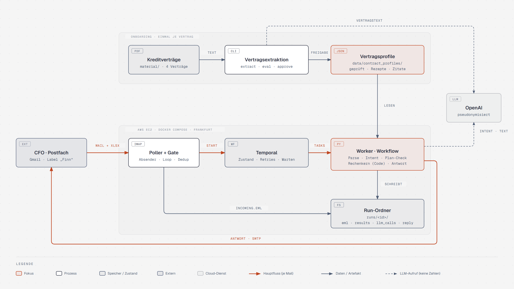
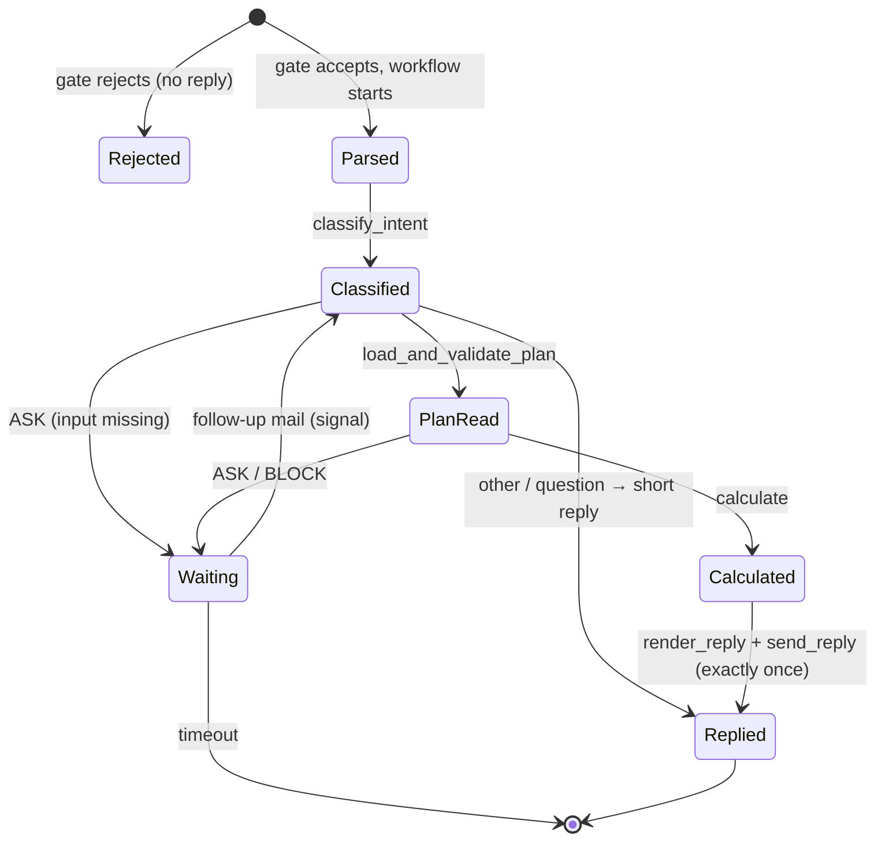

# Architecture



How Finn is built. Decisions are referenced as D# ([DECISIONS.md](DECISIONS.md)), error codes are in [FAILURES.md](FAILURES.md), task and answer key in [SCOPE.md](SCOPE.md). The code is the reference for details: models in `src/finn/models/`, settings in `src/finn/config.py` / `.env.example`.

## 1. Overview

- **Only outbound connections** (IMAP, SMTP, OpenAI); no public endpoint (D10). Poller and worker use the same Docker image with different commands.
- **The LLM never calculates** (D1). At runtime it only classifies the request and may polish the prose of the reply; every number comes from code and reviewed contract profiles.
- **Contracts are extracted once** into reviewed JSON profiles (`data/contract_profiles/`, D2); the mail flow only reads them.
- Layers (D27): core logic (`plan`, `calc`, `contracts`, `reply`) is pure; adapters (`mail`, `llm`) do I/O; orchestration (`pipeline`, `workflows`, `poller`) only wires. The direct runner (`finn process`) and the Temporal activities call the same `pipeline` functions.

## 2. Path of one mail

| # | Step | Module | Result |
|---|---|---|---|
| 1 | Poll `IMAP_FOLDER`, gate (headers only), save `.eml` to `runs/<ts>_<hash>/`, start or signal the workflow (ID = Message-ID) | `poller.py`, `mail/gate.py`, `mail/imap_smtp.py` | `StartRun` |
| 2 | Parse: body, attachments, thread; pseudonymise | `pipeline.parse_message`, `mail/parse.py`, `llm/redact.py` | `ParsedMessage` |
| 3 | Intent (LLM, rule fallback) + input contract (exactly one plan file) | `request/intent.py` | `Classified` |
| 4 | Read the plan: building blocks, facts, loans, checks | `plan/reader.py`, `plan/checks.py` | `PlanReadResult` |
| 5 | Calculate every covenant of every profile | `calc/engine.py` | `Report` |
| 6 | Render the reply (template, optional polish, number check) | `reply/render.py`, `reply/polish.py` | `ReplyDraft` |
| 7 | Send once (sent marker → Sent folder → SMTP) | `pipeline.send_reply`, `mail/imap_smtp.py` | `SentRecord` |

Stopping findings (ASK / BLOCK, `errors.stopping`) end steps 3–4 with an ASK or BLOCK reply; the workflow then waits for a follow-up in the thread (signal `new_message`, timeout `WAIT_FOR_INPUT_DAYS`) and recomputes from scratch (D8). Each step writes its audit file to the run folder (`runs.py`): `incoming.eml`, `request.json`, `plan_inputs.json`, `checks.json`, `results.json`, `pseudonyms.json`, `llm_calls.jsonl`, `reply.*`, `sent/`, `log.txt`, `error.txt`.



## 3. Components → modules

```
src/finn/
├── config.py, log.py (structlog → stderr), errors.py (ErrorCode, Finding, templates), runs.py
├── numbers.py             German number parse/format, Decimal(str(x))
├── wording.py · text.py   German result wording · plain-text table
├── models/                mail, plan, contract (profile schema), result, run (activity payloads)
├── plan/                  workbook, labels, reader, loans, facts, formulas, checks, render
├── calc/                  recipe, evaluator, rounding, sensitivity, formula, notes, loan_checks,
│                          engine, report_text (`finn check`)
├── contracts/             pdf_text, draft, extract, prompts/, validate, completeness, eval,
│                          report, selftest, store
├── mail/                  connector (protocol), imap_smtp, gate, parse, thread
├── llm/                   client (OpenAI), redact (pseudonyms, masker), fake (TEST ONLY)
├── request/               intent + prompts/intent.md
├── reply/                 render, calc_path, text_layout, polish + prompts/polish.md,
│                          number_check, templates/mail.{html,txt}.j2
├── pipeline.py            every step as a plain function (direct runner = same functions)
├── workflows/             activities, covenant_check (workflow), worker
├── poller.py · runtime.py Temporal connection with backoff, stop handlers
└── cli.py                 worker · poller · check · process · plan · contracts · demo
tests/  unit/ · integration/ (pipeline on .eml) · workflow/ (Temporal test server) · live/ (GreenMail) · fixtures/
```

## 4. Contract profiles and recipes (D2–D5, D28)

One JSON file per contract, schema in `models/contract.py`: verbatim `sources` (page, section, quote) referenced by ID from every component, threshold and clause; the contract's own `definitions` (EBITDA, Finanzverbindlichkeiten, …) and `conditions`; `loans` with loan-number matching and repayment schedule; `covenants` with numerator / denominator, operator, thresholds, unit, rounding, plan check, breach consequence, cure; `pricing_grid`, printed `examples`, `dismissed_mentions` (numbers that are **not** covenants), `review` and `extraction` metadata. Excerpt (V4, [full gold profile](../tests/fixtures/profiles_gold/V4.json)):

```json
{"covenant_id": "V4-DVG", "metric_type": "net_debt_to_ebitda",
 "numerator":   [{"ref": "net_financial_debt", "weight": "1", "source_id": "S_DVG_DEF"}],
 "denominator": [{"ref": "ebitda", "weight": "1", "source_id": "S_DVG_DEF"}],
 "operator": "<=", "thresholds": [{"from_year": 2023, "value": "3.50"}], "unit": "ratio",
 "rounding": {"decimals": 2, "method": "half_up", "source_id": "S_RUND"},
 "plan_check": {"applies": true, "consequence": "early_warning_only", "...": "..."},
 "breach_consequence": {"type": "event_of_default", "source_id": "S_KG"}}
```

**Recipes** (D5): a covenant references definitions, which combine building blocks with weights and conditions. Component fields: `item` or `ref`, `weight`, `exclude_if` / `only_if` (a contract condition, decided by a plan fact), `if_missing` (`partial` | `assume_zero_warn` | `assume_zero_info`), `loan_filters`. A whitelist (`calc/recipe.py`, D23) allows only building blocks, definitions without cycles, known conditions, one division, contract rounding and one comparison; anything else is `unmapped_components` → `manual_review`, never a guess.

| Covenant | Numerator | Denominator | Answer key |
|---|---|---|---|
| V2 economic equity ratio | `equity` + **0.5 ×** `sonderposten` | `total_assets` | 34.32 % |
| V3 DSCR | `ebitda` − `income_taxes` | interest excl. unwinding + scheduled repayments **incl.** shareholder loan | 1.56 |
| V4 equity ratio | `equity` | `total_assets` | 30.7 % |
| V4 dynamic leverage | `financial_debt` (shareholder loan **out** if qualified subordination) − `cash` if freely available | `ebitda` | 3.37 |

**Onboarding** is a command, not a service: `finn contracts extract` (full page-tagged text, no RAG, D3; strict-schema `ProfileDraft` → `ContractProfile`; quote repair; second review call → `<id>.review.json`; re-run only when the PDF hash or the prompt version `v1-<hash>` changes) → `finn contracts check` (quotes verbatim, whitelist, completeness scan, printed examples, D4) → `finn contracts eval` (semantic diff vs. gold profiles + answer key) → human review → `finn contracts approve V4 --by NAME` → commit.

## 5. Plan reader (D6, D22, D24)

Contract-neutral: rows found by **label synonyms × plan-year column**, on any sheet; every value keeps its cell. Output: building blocks (`ItemKey`: GuV, Bilanz and loan-schedule items), loan lines, plan facts (`FactKey`: qualified subordination, cash freely available; per loan: bullet, refinanced) decided by pattern rules on notes; unclear facts take the **conservative** value with an alternative result (`PLAN_FACT_AMBIGUOUS`).

- Units detected per sheet, normalised to T€ when reading; unclear → BLOCK. Signs normalised to positive magnitudes (except net income and equity).
- We don't audit the workbook (D22): we check the figures we use for consistency (balance, loan schedule vs. balance sheet, interest, opening balances, company, year, units) and recompute simple formulas when cached values are missing (`plan/formulas.py`).
- The full list of input checks and reactions: [FAILURES.md](FAILURES.md). `finn plan read <file>` shows every block with value and cell.

## 6. Calculation (D1, D5, D15, D23, D24)

Same profile + same plan → same result. `calc/evaluator.py` evaluates weighted sums and one division over `Decimal`, resolving `ref`s to the contract's own definitions and recording a trace (`Used` / `Excluded` / `AssumedZero`) that becomes the calculation path in the mail; `formula_de` is generated from the same trace. Then:

- **Rounding** half-up as the contract says (none → 2 decimals, `CALC_NO_ROUNDING_RULE`); the **rounded** value is compared.
- **Headroom** in pp for percentages; **tight** = headroom below `TIGHT_HEADROOM_RATIO` (10 %) of the limit.
- **Sensitivity** (D15): how far EBITDA or equity may fall before the rounded value breaks, solved algebraically and verified in whole T€ (`calc/sensitivity.py`); the **tightest** covenant is the one with the smallest such drop.
- **Alternatives** for ambiguous plan facts; contract notes (no covenants, margin step, plan-check duties, cure) in `calc/notes.py`; contract ↔ plan loan checks in `calc/loan_checks.py`.

Worked example V4 dynamic leverage: bank debt 148,200 [Bilanz!D28] − cash 12,600 [Bilanz!D12] (shareholder loan excluded: Bilanz note 2, qualified subordination) = 135,600; / EBITDA 40,200 = 3.3731 → **3.37 ≤ 3.50**, headroom 0.13, tight; with the shareholder loan it would be 3.57 (the trap).

## 7. Mail handling (D11, D12, D19, D20)

- **Connector** protocol (`mail/connector.py`): `fetch_new`, `mark_processed`, `send_reply`, `was_sent`. Implementation: `ImapSmtpConnector` (Gmail and plain IMAP; provider specifics are documented at its methods). Finn reads only `IMAP_FOLDER` and moves processed mail to `IMAP_PROCESSED_FOLDER`.
- **Gate** (`mail/gate.py`), headers only: tenant / licence (stubs) · loop headers and own address · recipient = `FINN_ADDRESS` · DMARC (`REQUIRE_DMARC_PASS`) · sender rules `ALLOWED_SENDERS` (`*` in demo mode). Rejected mail is logged as a security event: no reply, attachments never parsed, no workflow.
- **Poller** (D20): a stateless loop; mail is marked processed only after the workflow start or signal; the next cycle is the retry; a follow-up in a thread signals the waiting workflow, otherwise a new run starts.
- **Thread**: `In-Reply-To` / `References`, subject as fallback (`mail/thread.py`). Revised plan in the thread → new run from scratch.
- **Reply** (D14, D21): code fills `templates/mail.{html,txt}.j2` (result, ask, block, other, error): lead box, table with status and footnotes, notes, one calculation path per covenant (source, formula in words, input values with cells, result, "Besonderheit"), shared EBITDA derivation, reference. The optional polish rewrites only lead sentences and notes; the LLM sees `{{N1}}` / `{{NAME1}}` placeholders, and any changed placeholder or number falls back to the template (`reply/number_check.py`). The golden mail is `tests/fixtures/replies/result_sample.txt`.
- **Send**: deterministic Message-ID (workflow ID + sequence + kind), `AW:` subject, `In-Reply-To` / `References`, sent marker in the run folder, Sent-folder check (`was_sent`).

## 8. Temporal (D9)

Workflow `CovenantCheckWorkflow` (`workflows/covenant_check.py`), activities = methods of `FinnActivities` (sync, thread pool, mailbox injected for tests). Rules for the workflow code:

- No I/O in the workflow (files, IMAP, LLM, Excel run in activities); time from `workflow.now()`, waiting via `workflow.wait_condition`.
- Payloads are paths and Pydantic models (pydantic data converter, decimals as strings), never file contents.
- Every activity has a timeout and a retry policy: parse 3×, intent / render 5× (the LLM client retries itself, `LLMUnavailable` falls back inside the step), plan / calculate once (deterministic), send 12× up to ~1 h; validation errors and mailbox auth failures are non-retryable.
- LLM results are recorded in the history: on replay they are not requested again.
- An activity failure → `error.txt` + a polite error mail with the reference; the workflow fails visibly in the UI.

## 9. LLM usage and data minimisation (D16, D21)

| Call | Input | Removed before the call |
|---|---|---|
| Contract extraction + review (onboarding) | full page-tagged contract text, `contracts/prompts/` | natural persons' names (`contracts/pdf_text.py`) |
| Intent (each mail) | pseudonymised thread, attachment list, `request/prompts/intent.md` | emails, phones, IBANs, sender name, quotes, signatures |
| Polish (each result mail, optional) | lead sentences and notes, `reply/prompts/polish.md` | every number and name → placeholders |

Plan values never go to the LLM. `llm/client.py` makes one structured-output call (Responses API, strict schema, model `OPENAI_MODEL`) and turns every failure into `LLMUnavailable`; the mapping of pseudonyms stays in the run folder.

## 10. Observability (D13)

- **Run folder** `runs/<ts>_<hash>/` = the audit trail (git-ignored); `llm_calls.jsonl` holds the pseudonymised prompts and answers.
- **Temporal Web UI** (`:8233`, local only): runs, steps, retries, waiting workflows.
- **Logs** (`log.py`, structlog to stderr, `LOG_FORMAT` console | json): per LLM call `purpose`, `model`, `trace_id` (= workflow ID), `session_id` (= mail thread), tokens and seconds, never prompts; security events `access_rejected`, `auth_failed`, `loop_ignored`.

## 11. Deployment

**Compose** (`docker-compose.yml`): `temporal` (dev server, SQLite on a volume, ports bound to 127.0.0.1), `finn-worker`, `finn-poller` (image `finn:dev`, non-root, `.env` never baked in, `restart: unless-stopped`). `docker compose up -d` is the whole runtime; Finn has no database of its own.

**Test mail profile** `testmail` (never touches the real mailbox): GreenMail (SMTP 3025, IMAP 3143), Roundcube on `http://localhost:8080`, and `finn-worker-testmail` / `finn-poller-testmail` (image `finn:testmail`, task queue `finn-testmail`, `runs-testmail/`, env from `.env.testmail.example`, LLM stand-in `llm/fake.py` unless `--real-llm`). `uv run pytest -m mailserver` runs the 21 cases of `tests/live/cases.py` against GreenMail; `finn demo send-cases` sends them to the containers; both write `out/replies/index.html`.

**AWS** (`aws/`, own uv project, CDK Python): stack `FinnDemo` in eu-central-1, names in `aws/demo_config.py`.
- One EC2 `t3.small` (Ubuntu 24.04, IMDSv2, encrypted gp3) in its own VPC with one public subnet; security group without inbound rules; access only via SSM Session Manager.
- Code: an S3 asset of the repo (no `.env`, runs, tests, docs, `aws/`); its URL in the SSM parameter `/finn/demo/asset-url`. Secrets: one SecureString `/finn/demo/env`, written by `aws/put_env.py`, only referenced by name in CDK.
- First boot (user data): Docker, AWS CLI, `/usr/local/bin/finn-deploy` → fetch asset + `.env` to `/opt/finn`, `docker compose up -d --build temporal finn-worker finn-poller`; log `/var/log/finn-bootstrap.log`.
- Redeploy: `cdk deploy` with changed code updates the asset parameter, and a custom resource sends `finn-deploy` via SSM Run Command; the instance is not replaced (`test_logical_ids_are_stable` guards the user data). `aws/status|logs|redeploy` (`.sh` / `.ps1`, `aws/ops.py`) operate the instance via SSM.

```
uv run --no-project python aws/put_env.py                       # .env → SSM (values never printed)
cd aws && npx -y aws-cdk@2.1146.1 diff && npx -y aws-cdk@2.1146.1 deploy
aws/status.ps1 | aws/logs.ps1 finn-poller | aws/redeploy.ps1    # via SSM Run Command
```
Only one poller may watch the Gmail label: stop the local default services before the cloud one runs.
