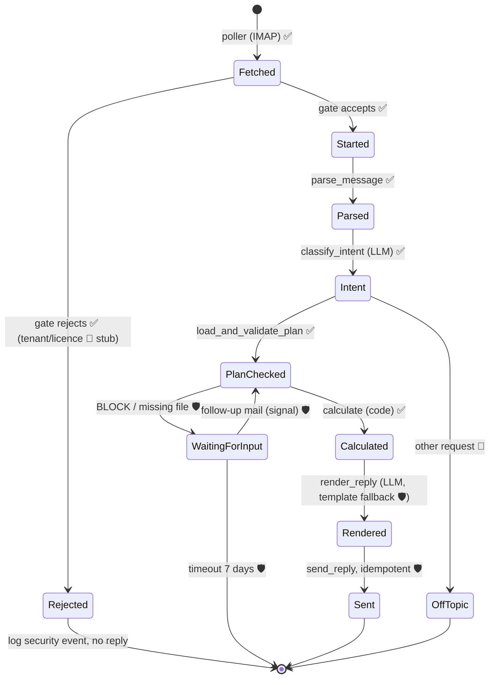

# Architecture

How Finn is built for the case study, and where it is designed to grow. Decisions are referenced as D#, see [DECISIONS.md](DECISIONS.md).

## 1. Overview

```
  Sender (CFO / reviewer)
          │ mail with Wirtschaftsplan.xlsx
          ▼
  ┌───────────────┐  IMAP poll (~15 s)  ┌──────────────┐
  │ Mailbox       │ ◄────────────────── │ finn-poller  │──┐ start workflow (ID = Message-ID)
  │ (dedicated)   │                     └──────────────┘  │ or signal waiting workflow (same thread)
  └───────▲───────┘                                       ▼
          │ SMTP reply (same thread)         ┌────────────────────────┐
  ┌───────┴───────┐  polls for tasks /       │ Temporal server + UI   │
  │ finn-worker   │ ◄──────────────────────► │ (state on a volume)    │
  │ workflow +    │  reports results         └────────────────────────┘
  │ activities    │ ──► OpenAI ──► Langfuse traces
  │               │ ──► run folder (files, results, reply)
  └───────────────┘ ──► data/contract_profiles/*.json (reviewed, read-only at runtime)
```

- **Only outbound connections** (IMAP, SMTP, OpenAI, Langfuse). No public endpoint; the stack runs on a laptop or any VM (D10).
- Poller and worker use **the same Docker image** with different commands.
- Contract extraction is a **separate one-time command**, not part of the mail flow (D2).

## 2. Two pipelines

### 2.1 Contract onboarding (once per contract version)
```
PDF ─► page texts (cached, hashed) ─► LLM extraction (full text, fixed schema)
    ─► validation: quotes exist on stated page · schema · thresholds parse
    ─► completeness: keyword scan, every hit = covenant or dismissed-with-reason
    ─► second LLM pass: full text + profile → omissions / modifying clauses?
    ─► human review ─► data/contract_profiles/<id>.json (committed)
```
Command: `finn contracts extract` (re-runs only for changed hashes) · `finn contracts check` (validation only).

### 2.2 Mail run (every request)
```
poller:    fetch ─► gate (headers only) ─► save .eml + attachments ─► start / signal workflow
workflow:  parse ─► intent ─► plan read + checks ─► calculation ─► reply ─► send (exactly once)
```
The **poller decides who may enter**; the **workflow decides what to do with it** (see §6.1, §7).
At runtime the LLM only classifies the request and writes the text. **No number depends on the LLM** (D1, D16).

## 3. Contract profile schema

```jsonc
{
  "contract_id": "V4", "file": "Vertrag_4_Konsortialkredit.pdf", "sha256": "…",
  "schema_version": 1,
  "lender": "Weserland Bank AG (Agent)", "borrower": "Stadtwerke Musterstadt GmbH",
  "loan_number": null, "amount_eur": "64000000.00",
  "has_financial_covenants": true,
  "dismissed_mentions": [
    {"page": 4, "section": "§ 6 Abs. 3", "quote": "…Margenraster…", "reason": "pricing only, § 6 Abs. 4"}
  ],
  "covenants": [{
    "covenant_id": "V4-DVG",
    "metric_type": "net_debt_to_ebitda",          // equity_ratio | net_debt_to_ebitda | dscr
    "name_in_contract": "Dynamischer Verschuldungsgrad",
    "operator": "<=", "threshold": "3.50", "unit": "ratio",   // ratio | percent
    "test_date": "annual, 31.12.",
    "rounding": {"decimals": 2, "method": "half_up"},
    "parameters": { /* see 3.1 */ },
    "sources": [ {"role": "covenant|definition|rounding|plan_basis", "page": 7, "section": "§ 14 Abs. 1 lit. b", "quote": "…"} ],
    "related_clauses": [ {"type": "plan_basis_not_default|cure|no_cure|pricing_only", "page": 7, "section": "§ 14 Abs. 3", "quote": "…"} ],
    "unmapped_components": [],                     // non-empty → not calculated, manual review
    "confidence": "high"
  }]
}
```
Thresholds and amounts are **strings** holding exact decimals (also for Temporal serialisation).

### 3.1 Parameters per metric type (D5)

| Type | Formula | Parameters | V2 | V3 | V4 |
|---|---|---|---|---|---|
| `equity_ratio` | (equity + s × Sonderposten [+ shareholder loan]) / total assets | `sonderposten_share` | 0.5 | – | 0.0 |
| | | `include_shareholder_loan` | false | – | false |
| `net_debt_to_ebitda` | (bank debt [+ shareholder loan] − cash) / EBITDA | `shareholder_loans` | – | – | `exclude_if_qualified_subordination` |
| | | `cash` | – | – | `freely_available_only` |
| `dscr` | (EBITDA − income taxes) / (interest + scheduled repayments) | `include_shareholder_loan` | – | true | – |
| | | `exclude_provision_unwinding` | – | true | – |
| | | `exclude_special_repayments` | – | true | – |
| EBITDA (shared) | JÜ + income taxes + interest expense − interest income + depreciation ± extraordinary (§ 285 Nr. 31 HGB) | `add_back`, `deduct`, `extraordinary_items` | – | std | std |

Conditional parameters (e.g. "exclude if qualified subordination") are resolved by code against plan facts (balance-sheet note 2), and the evidence is recorded.

## 4. Plan reader (D6)

The calculation needs ~20 **canonical items**. Mapping = finding the cell for each item, in three steps:

```
1. Deterministic reader   every sheet, any row/column: row label matches a synonym
                          ("Eigenkapital", "Summe Eigenkapital", "Eigenmittel") ×
                          column header matches the plan year ("Plan 2027", "31.12.2027")
        │ all required items found? ── yes ──► 3
        ▼ no
2. LLM mapping (fallback) the LLM gets a skeleton: sheet names, row labels, column headers,
                          cell coordinates, text notes; NO numeric values.
                          Returns: item → cell + short reason (structured output)
        ▼
3. Code reads the values and verifies: balance sheet balances · EBITDA derivable from GuV ·
   loan schedule = bank liabilities · company / plan year match
        │ pass → calculate; reply notes items mapped by step 2 (PLAN_MAPPING_LLM)
        └ fail → BLOCK / PARTIAL with the exact items (see FAILURES.md §F)
```
- The LLM decides **where** a value is, never **what** it is. A wrong mapping almost always breaks a tie-out check.
- Step 2 is a stretch goal in the case study (after the end-to-end flow works). Product: the confirmed mapping is stored per customer as a **plan profile** and reused every year.
- Test fixtures: renamed labels, moved rows, everything on one sheet, missing loan schedule.

Canonical items, by statement:

| Statement | Items |
|---|---|
| GuV | net income, income taxes, interest expense, of which pension unwinding, interest income, depreciation, (extraordinary items) |
| Bilanz | equity, Sonderposten, total assets, bank liabilities, shareholder loan, cash, sub-totals for checks |
| Finanzierung | per loan: opening balance, drawdowns, scheduled repayment, special repayment, closing balance, interest; loan identifier |
| Cover / notes | company name, plan year, units, status (draft/approved), subordination note, cash availability note |

- Every value is returned as `PlanValue(value: Decimal, sheet, cell, label)`.
- **Formulas:** `openpyxl` cannot evaluate formulas, and cached values may be missing or stale. We recompute every sub-total from input cells and compare with the cached value when it exists.

### 4.1 Input checks (D7)

Summary below; the complete list with error codes, reply wording and fixtures is in [FAILURES.md](FAILURES.md).

| Check | Severity |
|---|---|
| Readable `.xlsx` (not encrypted, not `.xls`/`.csv`) | BLOCK |
| Required statements found (GuV, Bilanz, Finanzierung) | BLOCK |
| Company name = borrower in the contract profiles | BLOCK |
| Plan year found; matches the year in the subject/body (if given); reporting date 31.12.YYYY | BLOCK on mismatch |
| Units detectable (T€ / € / Mio. €) | BLOCK if unclear |
| Balance sheet balances (assets = liabilities, recomputed) | BLOCK |
| Loan schedule closing balance = bank liabilities (balance sheet) | BLOCK |
| Every value needed by a covenant found | BLOCK for that covenant only → partial result |
| Interest per loan schedule + unwinding = GuV interest expense | WARN |
| Opening balances = previous year's closing balances | WARN |
| Every contract's loan appears in the loan schedule | WARN |
| Scheduled repayment in plan = contract repayment schedule | WARN |
| Sign conventions (expenses negative) | WARN |
| Plan status (draft / approved) | INFO |

Every reply begins with a header of **what was checked**: file name, company, plan year, version date, file hash, check results.

## 5. Calculation engine

- Pure functions: `compute(covenant_profile, plan) -> CovenantResult`. No I/O, no LLM.
- `Decimal` throughout; rounding as specified by the contract (`ROUND_HALF_UP`); where the contract specifies none, 2 decimals, flagged.
- Comparison uses the **rounded** value, as the contracts specify.
- `CovenantResult`: value, threshold, operator, headroom (unit: pp / ratio), met, tight flag, inputs (each with cell and label), formula string, sources.
- **Tight** = headroom < 10 % of the threshold (configurable). Answer key: V4 equity ratio and V4 leverage are tight.
- **Sensitivity:** for EBITDA-based covenants, the EBITDA drop at which the covenant would break; for equity ratios, the equity drop. Rounding-aware, computed in code.
- Regression test: the answer key in [SCOPE.md](SCOPE.md) §3.

## 6. Mail handling

### 6.1 Ingestion and gate (D11, D12, D19, D20)

**Connector interface** (one implementation per provider, same contract):
```python
class MailConnector(Protocol):
    def fetch_new(self, since: datetime) -> list[InboundMessage]: ...   # not yet processed, last N days
    def mark_processed(self, msg: InboundMessage) -> None: ...          # tag/flag, only after workflow start
    def send_reply(self, reply: OutboundReply) -> None: ...             # sets In-Reply-To / References
    def was_sent(self, message_id: str) -> bool: ...                    # Sent-folder check (idempotent send)
```
Case study: `ImapSmtpConnector`. Product: `GraphConnector` (M365), `GmailConnector` (Workspace), same interface (see [ROADMAP.md](ROADMAP.md) §4).

**`InboundMessage`** (normalised, provider-independent): `message_id`, `in_reply_to`, `references`, `from_addr`, `to_addrs`, `subject`, `date`, `auth_results` (SPF/DKIM/DMARC), `auto_submitted` flags, `raw_eml_path`, `attachment_paths`, `mailbox` (receiving address → tenant).

**Gate** = a plain Python function in the poller process, not a service and not a Temporal step:
`gate.check(msg) -> Accept(tenant) | Reject(reason)`. It reads **headers only**.

| # | Step | Case study | Product |
|---|---|---|---|
| 1 | Tenant by receiving mailbox | stub: one hard-coded tenant | tenant registry |
| 2 | Licence active | stub: always active | licence status (active / trial / expired) |
| 3 | Loop / auto-reply: `Auto-Submitted`, `Precedence: bulk/auto_reply`, `X-Autoreply`, own address | ✅ | ✅ |
| 4 | SPF/DKIM/DMARC from `Authentication-Results` | ✅ logged; `REQUIRE_DMARC_PASS` optional | required |
| 5 | Sender rules | ✅ `ALLOWED_SENDERS`, `*` = demo mode (the brief requires external senders) | per tenant, verified domains |
| 6 | Duplicate | Temporal: workflow ID = Message-ID | same |

**Sender rule syntax** (`ALLOWED_SENDERS`, comma-separated):
`*` (anyone, demo) · `cfo@stadtwerke-x.de` (exact) · `@stadtwerke-x.de` (domain) · `@*.stadtwerke-x.de` (any subdomain, e.g. departments) · `!praktikant@stadtwerke-x.de` (deny).
Precedence: **deny → exact → most specific pattern → reject**.

- Rejected → security event in the log (`access_rejected`, `auth_failed`, `loop_ignored`), **no reply, attachments never parsed, no workflow created**.
- Reply only to the verified `From` address, never to a differing `Reply-To`.
- **Deferred decision, licence expired (product):** reply once to the sender ("Lizenz abgelaufen, bitte Admin kontaktieren"), notify the tenant admin from the company settings, then ignore further mail from that tenant (logged, not processed). Not built.

**Poller loop** (stateless, D20):
```
every POLL_INTERVAL_SECONDS:
  try:
    for msg in connector.fetch_new(since=now - LOOKBACK_DAYS):
        if gate rejects:  log security event; connector.mark_processed(msg); continue
        save raw .eml + attachments → runs/<msgid>/
        if thread has a waiting workflow:  signal it (new_message, ref)
        else:  start CovenantCheckWorkflow(id=Message-ID, ref)   # duplicate ID = already handled
        connector.mark_processed(msg)                            # only after start/signal succeeded
  except connection / auth / throttling error:
    log; back off (longer after repeated failures); next cycle
```
Robustness rules: (1) never lose a mail: mark processed only after the workflow start; (2) never process twice: Message-ID dedup; (3) never send twice: deterministic reply Message-ID + `was_sent` check; (4) outages: log, back off, next cycle, nothing is lost because the mail stays in the inbox; (5) auth failures are loud: operator alert, no retry loop; (6) defensive parsing with size limits, keep the raw `.eml`; (7) fixture tests with real mails (Outlook, Gmail, Apple Mail, forwarded, umlauts in filenames, auto-reply, no attachment).

### 6.1a State diagram (demo)

✅ built · 🛡️ resilience path, built · 📐 designed, stub or not built



### 6.2 Intent (LLM → small schema, code decides)
`{"intent": "covenant_check" | "follow_up_input" | "other", "plan_year": 2027 | null, "notes": "…"}`.
The LLM reads the **whole thread** (D8), pseudonymised (§8.1). Code resolves the attachment: the latest valid `.xlsx` in the thread.
Each intent has an **input contract** (required / optional inputs), checked by code after classification; anything missing → ask and wait. See [FAILURES.md](FAILURES.md) "Intent input contracts".

### 6.3 Thread cases

| # | Situation | Behaviour | Case study |
|---|---|---|---|
| A | New, complete request | calculate, reply | ✅ |
| B | Attachment missing / wrong / unreadable | ask precisely; workflow **waits** for a follow-up in the thread (signal, timeout 7 days); follow-up + original request → continue | ✅ |
| C | Revised plan in the same thread | new run from scratch; optional diff vs. previous result | ✅ (diff optional) |
| D | New plan, new thread | independent run | ✅ |
| E | Follow-up question without file | answer from stored run + relevant contract text | roadmap |
| F | Auto-reply / own mail / loop | ignore | ✅ |
| G | Off-topic | short polite reply | optional |
| H | Several `.xlsx` / other plan year | pick by content; ask if ambiguous | partly |
| I | Duplicate mail / crash mid-run | workflow ID = Message-ID; idempotent send | ✅ |
| J | One covenant not computable | partial result, marked "nicht berechenbar" | ✅ |
| K | Contract file changed | hash mismatch → profile "not reviewed", stated in reply | ✅ (detect + warn) |

Thread identity: `In-Reply-To` / `References`, subject (`AW:`/`Re:`) as fallback.

### 6.4 Reply structure (German, HTML + plain text)
1. Header: checked input (file, company, plan year, status, hash) and any warnings at the top
2. Summary: overall result, tightest covenant, sensitivity sentence, "Frühwarnung auf Planbasis"
3. Table: contract · covenant · Plan 2027 · threshold · headroom · met
4. Calculation path per covenant: contract source (page/§ + quote), formula, inputs with cells, result
5. Notes: contract without covenants (and why), V4 margin step, related clauses (cure / no cure)
6. Signature + "Alle Kennzahlen stammen aus deterministischem Code, nicht aus dem Sprachmodell."

The LLM writes text around **placeholders filled by code**; afterwards code verifies that every number in the mail equals the result. If the LLM is unavailable → a fixed German template (D16).

## 7. Orchestration with Temporal (D9)

### 7.1 Workflow
```
CovenantCheckWorkflow(message_ref)                 workflow ID = Message-ID (gate already passed)
  msg    = parse_message(message_ref)              body, attachments metadata, thread
  req    = classify_intent(thread)                 (LLM; does the request match the content?)
  plan   = load_and_validate_plan(attachment_path)
  while plan blocked/missing:
      send_reply(ask_for_input)                    (once)
      wait_condition(new_message signal, timeout=7d)
      plan = load_and_validate_plan(...)
  profiles = load_contract_profiles()
  results  = calculate(profiles, plan)
  reply    = render_reply(results)                 (LLM + template fallback + number check)
  send_reply(reply)                                (exactly once)
  archive_run(...)
```

### 7.2 Rules for workflow code
- **No I/O** in workflow code: network, files, IMAP/SMTP, LLM, Excel/PDF all run in **activities**.
- No `datetime.now()`, `random`, `uuid4()` → use `workflow.now()`, `workflow.random()`, `workflow.uuid4()`.
- No `time.sleep()`/threads → `asyncio.sleep()` / `workflow.wait_condition()`.
- **Pass file paths, not file contents** (payload limit ~2 MB per event).
- Decimals as strings / Pydantic models with an appropriate data converter.
- Every activity has `start_to_close_timeout` and a retry policy; validation errors are **non-retryable** application errors.
- Code changes affecting waiting workflows → `workflow.patched()`.
- LLM results are recorded in the history: after a crash they are **replayed, not re-requested**.

### 7.3 Activities and retries

| Activity | Retries | Notes |
|---|---|---|
| `parse_message` | yes | reads the saved `.eml`; unparseable → polite reply, raw mail kept |
| `classify_intent`, `render_reply` (LLM) | yes, backoff, max ~5 | fallback: template reply |
| `load_and_validate_plan`, `calculate` | no (deterministic) | failures are input errors → reply |
| `send_reply` | **guarded** | own Message-ID created first; skip if already sent (sent marker / Sent folder) |

### 7.4 Poller
A plain long-running process (compose `restart: unless-stopped`), **not a Temporal workflow** (D20). Loop, gate and robustness rules: §6.1. Its only Temporal calls are `start_workflow` and `signal`; the workflow receives paths, never file contents.
Two kinds of retry: **poller** = no retry logic, the next cycle is the retry (mail stays in the inbox); **workflow** = Temporal retry policies per activity (parse, LLM, send).

### 7.5 Direct runner
`finn process path/to/mail.eml [--no-send]`: same activities, called in sequence without Temporal. Used for tests, development and as a safety net in the demo.

## 8. LLM usage

| Call | When | Input | Output |
|---|---|---|---|
| Covenant extraction | onboarding | full contract text (per page, page-tagged) | contract profile (structured output) |
| Extraction review | onboarding | full text + profile | list of omissions / issues |
| Plan mapping (fallback) | only if the deterministic reader misses items | workbook skeleton, no values | item → cell mapping |
| Intent | each mail | thread text (no attachment contents) | intent schema |
| Reply text | each mail | results with placeholders | German mail text |

### 8.1 Data minimisation (D21)

| Call | What the LLM gets | Removed / replaced before the call |
|---|---|---|
| Contract extraction | full contract text | signatory names → `[PERSON_n]` (lenders, amounts, clauses stay: they are the content) |
| Plan mapping (fallback, §4) | workbook skeleton: sheet names, labels, headers, coordinates, text notes | all numeric values |
| Intent | pseudonymised thread | emails, phone numbers, IBANs (regex), sender name (from `From`) → `[EMAIL_n]`, `[PERSON_n]`, …; quoted history and signatures stripped |
| Reply text | covenant IDs, result flags (met / tight), check findings | all numbers, names and the company → placeholders such as `{{V4_DVG_VALUE}}`, `{{SENDER_NAME}}`, filled by code afterwards |
| – | plan **values** | never sent (labels only, and only in the mapping fallback) |

- The placeholder mapping lives in the run folder (`pseudonyms.json`), never in a prompt.
- Langfuse traces contain only the pseudonymised prompts.
- Module: `src/finn/llm/redact.py` (pseudonymise / restore), with tests.

### 8.2 Client
- OpenAI structured outputs (JSON schema), low temperature, model configurable via env.
- SDK retries with exponential backoff; timeouts set.
- Provider failover: **documented, not built** (retry first, then a second provider with the same schema; validation catches schema drift).

## 9. Observability (D13)

| Layer | Tool | Content |
|---|---|---|
| Workflow | Temporal Web UI (`:8233`, keep private) | runs, steps, inputs/outputs, retries, waiting states |
| LLM | Langfuse (optional via env) | prompts, responses, tokens, cost, latency; **trace ID = workflow ID**, **session = mail thread** |
| Audit | run folder `runs/<ts>_<msgid>/` | `incoming.eml`, `plan_inputs.json`, `checks.json`, `results.json`, `reply.html`, `llm_calls.jsonl`, `log.txt`, `error.txt` |
| Live | console | readable step log (also shown in the demo) |

Structured log events carry `run_id`, `thread_id`, `step`, `severity`. Security events: `access_rejected`, `auth_failed`, `loop_ignored`.
Later: Temporal → OpenTelemetry → Langfuse for one end-to-end trace.
`runs/` is git-ignored (contains mail content).

## 10. Errors and resilience

| Failure | Behaviour |
|---|---|
| OpenAI down / rate limited | retries with backoff → template reply (numbers unaffected) |
| IMAP unavailable | poller logs, backs off, next cycle; mail stays in the inbox |
| SMTP unavailable | `send_reply` activity retries; Temporal keeps state |
| Mailbox auth fails | non-retryable; operator alert (product: tenant admin too) |
| Worker crash / restart | Temporal resumes at the last completed step |
| Invalid / wrong plan | BLOCK → German mail stating exactly what is wrong; workflow waits for a corrected file |
| Missing value for one covenant | partial result |
| Contract changed since review | warning in the reply; profile needs re-review |
| Unexpected exception | sender: polite mail with reference ID; operator: `error.txt` + stack trace |

## 11. Configuration (`.env`, never committed)

```
OPENAI_API_KEY, OPENAI_MODEL
IMAP_HOST, IMAP_PORT, IMAP_USER, IMAP_PASSWORD
SMTP_HOST, SMTP_PORT, SMTP_USER, SMTP_PASSWORD
FINN_ADDRESS, ALLOWED_SENDERS=*, REQUIRE_DMARC_PASS=false
CONTRACTS_DIR=material, PROFILES_DIR=data/contract_profiles, RUNS_DIR=runs
TEMPORAL_ADDRESS=temporal:7233, TEMPORAL_TASK_QUEUE=finn
LANGFUSE_PUBLIC_KEY, LANGFUSE_SECRET_KEY, LANGFUSE_HOST   (optional)
POLL_INTERVAL_SECONDS=15, LOOKBACK_DAYS=3, TIGHT_HEADROOM_RATIO=0.10
```

## 12. Repository layout (planned)

```
src/finn/
  config.py            settings from env
  models.py            shared Pydantic models (PlanValue, CovenantProfile, CovenantResult, …)
  plan/                reader.py · labels.py · skeleton.py · llm_mapping.py · checks.py
  errors.py            error codes (FAILURES.md) + German reply templates
  contracts/           pdf_text.py · extract.py · schema.py · validate.py · completeness.py
  calc/                metrics.py · ebitda.py · rounding.py · engine.py
  mail/                connector.py · imap_smtp.py · parse.py · gate.py · render.py · templates/
  llm/                 client.py (OpenAI + retries + Langfuse) · redact.py (pseudonymise / restore)
  workflows/           covenant_check.py · activities.py · worker.py · poller.py
  runs.py              run folder
  cli.py               finn contracts extract|check · finn process · finn worker · finn poller
data/contract_profiles/   reviewed profiles (committed)
material/                 contracts + sample plan (CONTRACTS_DIR)
tests/                    plan, checks, calc (answer key), mail parsing, workflow (Temporal test env)
tests/fixtures/           one .xlsx / .eml per failure case (FAILURES.md)
docker-compose.yml        temporal (dev server, volume) · finn-worker · finn-poller
```

## 13. Deployment

- **Local / demo:** `docker compose up -d` (Temporal dev server with persisted state + UI, worker, poller).
- **Cloud demo:** one small VM (AWS / Azure / Hetzner): Docker, `git clone`, `.env`, `docker compose up -d`. No inbound ports. Temporal UI via SSH tunnel only. Test the mailbox login from the VM's IP a day before the demo.
- **Production:** self-hosted Temporal with Postgres, or Temporal Cloud with client-side payload encryption; EU hosting; secrets in a secret store. See [ROADMAP.md](ROADMAP.md).
