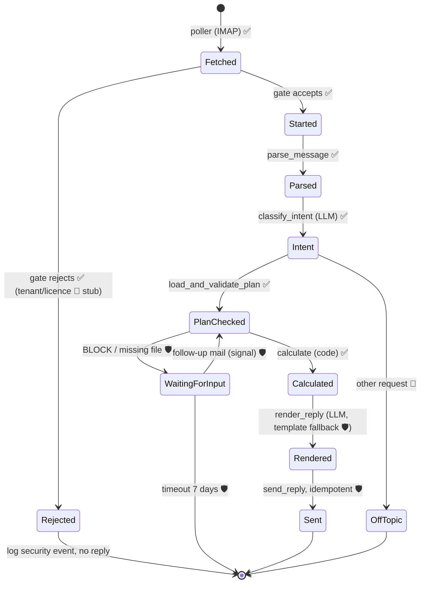

# Architecture

How Finn is built for the case study, and where it is designed to grow. Decisions are referenced as D#, see [DECISIONS.md](DECISIONS.md).

## 1. Overview

```
  Sender (CFO / reviewer)
          │ mail with Wirtschaftsplan.xlsx
          ▼
  ┌───────────────┐  IMAP poll (~15 s)  ┌──────────────┐
  │ Mailbox       │ ◄────────────────── │ finn-poller  │──┐ start workflow (ID = Message-ID)
  │ (dedicated)   │                     └──────────────┘  │ or signal waiting workflow (same thread)
  └───────▲───────┘                                       ▼
          │ SMTP reply (same thread)         ┌────────────────────────┐
  ┌───────┴───────┐  polls for tasks /       │ Temporal server + UI   │
  │ finn-worker   │ ◄──────────────────────► │ (state on a volume)    │
  │ workflow +    │  reports results         └────────────────────────┘
  │ activities    │ ──► OpenAI (pseudonymised prompts, logged in llm_calls.jsonl)
  │               │ ──► run folder (files, results, reply)
  └───────────────┘ ──► data/contract_profiles/*.json (reviewed, read-only at runtime)
```

- **Only outbound connections** (IMAP, SMTP, OpenAI). No public endpoint; the stack runs on a laptop or any VM (D10).
- Poller and worker use **the same Docker image** with different commands.
- Contract extraction is a **separate one-time command**, not part of the mail flow (D2).

## 2. Two pipelines

### 2.1 Contract onboarding (once per contract version)
```
PDF ─► page texts (cached, hashed) ─► LLM extraction (full text, fixed schema)
    ─► validation: quotes exist on stated page · schema · thresholds parse
    ─► completeness: keyword scan, every hit = covenant or dismissed-with-reason
    ─► second LLM pass: full text + profile → omissions / modifying clauses?
    ─► human review ─► data/contract_profiles/<id>.json (committed)
```
Command: `finn contracts extract` (re-runs only for changed hashes) · `finn contracts check` (validation only). A developer command, not a service (§13.2).

As built (increment 6):
- **Draft schema instead of the profile as structured output.** OpenAI strict JSON schema requires every property and allows no free-form maps; the profile has dicts (`conditions`, `definitions`, `label_hints`, `examples[].inputs`), defaults and decimals. The LLM returns `ProfileDraft` (`contracts/draft.py`: lists with `id`/`key`, explicit `null`, decimals as strings, no file/hash/review fields); code converts it into a `ContractProfile` and fills `document`, `extraction` (model, `prompt_version`, `extracted_at`, `source_sha256`) and `review.status = draft`. A draft that fails validation is sent back once with the errors.
- **Quotes:** near misses (right text on another page, or only punctuation / case differ) are replaced by the exact page text and noted in `review.notes`; anything else is reported (`PROFILE_QUOTE_MISMATCH`).
- **Review output:** the second pass is stored as `<id>.review.json` next to the profile (LLM issues + validation lines + uncovered completeness hits); the store ignores `*.review.json`.
- **Re-extraction** when the PDF hash or the prompt version changed; the prompt version is `v1-<hash of both prompts and both schemas>`, so any prompt edit counts.
- **Eval and approval:** `finn contracts eval` (semantic diff against the gold profiles + answer key with the extracted profiles), `finn contracts approve V4 --by NAME` (the human review step; refuses while quotes / recipes fail).

### 2.2 Mail run (every request)
```
poller:    fetch ─► gate (headers only) ─► save .eml + attachments ─► start / signal workflow
workflow:  parse ─► intent ─► plan read + checks ─► calculation ─► reply ─► send (exactly once)
```
The **poller decides who may enter**; the **workflow decides what to do with it** (see §6.1, §7).
At runtime the LLM only classifies the request and writes the text. **No number depends on the LLM** (D1, D16).

### 2.3 Data contracts

Every arrow is one Temporal activity, every box one Pydantic model (`src/finn/models/` is the source of truth; this is the overview). Money is `Decimal`, serialised as a string.

```
InboundMessage ─parse_message─► ParsedMessage ─classify_intent─► Request
                                                                    │
           ┌──────────────────────── load_and_validate_plan ────────┘
           ▼
   WorkbookSkeleton ─map─► PlanMapping ─read─► Plan + list[Finding]
                                                  │
   ContractProfile[] ─────────── calculate ───────┤
                                                  ▼
                            Report (results + findings + notes, §6.4)
                                                  │ render_reply
                                                  ▼
                                    ReplyDraft ─send_reply─► SentRecord
```

```python
# ── Mail ─────────────────────────────────────────────
InboundMessage:  message_id, in_reply_to, references[], from_addr, to_addrs[],
                 subject, date, auth_results, auto_submitted, mailbox,
                 raw_eml_path, attachment_paths[]            # from the poller
ParsedMessage:   inbound, body_text (pseudonymised), thread: list[ThreadMessage],
                 attachments: list[Attachment]
Attachment:      path, filename, content_type, size, sha256,
                 kind: xlsx|xlsm|xls|pdf|zip|tnef|other
Request:         intent: covenant_check|follow_up_input|question_about_result|other,
                 plan_year: int|None, contract_filter: list[str]|None,
                 confidence, assumptions: list[str], unsupported: list[str]

# ── Plan ─────────────────────────────────────────────
WorkbookSkeleton: sheets: list[SheetSkeleton]  # labels, headers, coordinates, no values
SheetSkeleton:    name, hidden, unit_label, header_cells, row_labels, text_notes
PlanMapping:      items: dict[ItemKey, CellRef], source: dict[ItemKey, "rule"|"llm"],
                  reasons: dict[ItemKey, str]
CellRef:          sheet, cell                  # "Bilanz", "D22"
PlanValue:        item: ItemKey, value: Decimal (T€, normalised), ref: CellRef, label,
                  original_unit, derived_from: list[CellRef]   # if recomputed
PlanFact:         key: FactKey | LoanFactKey, value: bool, evidence: CellRef|None, quote,
                  ambiguous: bool               # unclear → conservative value (see §4.1)
Plan:             company, plan_year, reporting_date, status: draft|approved,
                  version_date, file_sha256,
                  values: dict[ItemKey, PlanValue],   # building blocks (§4.1)
                  loans: list[LoanLine], facts: dict[FactKey, PlanFact]
LoanLine:         label, loan_number|None, kind: bank|shareholder|other, opening, drawdown,
                  scheduled_repayment, special_repayment, closing, interest,
                  refs: dict[str, CellRef], facts: dict[LoanFactKey, PlanFact]   # bullet / refinanced
Finding:          code (FAILURES.md), severity: REJECT|IGNORE|ASK|BLOCK|PARTIAL|WARN|INFO,
                  message_de, refs: list[CellRef],
                  items: list[str],             # building blocks / facts concerned (set by the reader)
                  affects: list[covenant_id]|"all"   # set by the calc engine from items (BLOCK/ASK: "all")
PlanReadResult:   plan: Plan|None, findings: list[Finding], mapping_log

# ── Contracts (onboarding, reviewed JSON) ────────────
ContractProfile:  §3 (covenants with recipes, sources, …)   # models/contract.py

# ── Calculation ──────────────────────────────────────
CovenantResult:   covenant_id, contract_id, name_de,
                  status: met|breached|not_computable|manual_review,
                  value_raw, value_rounded, threshold, operator, unit,
                  headroom, headroom_unit: pp|ratio|T€, tight, sensitivity,
                  components: {numerator, denominator}: list[Used|Excluded|AssumedZero]  # nested for refs
                  formula_de: str,                   # generated from the trace, e.g. "(96.100 + 0,5 × 22.800) / 313.200"
                  sub_formulas_de, alternatives (unclear plan facts), findings: list[Finding],
                  sources: list[Source], reason: str|None          # models/result.py

# ── Reply ────────────────────────────────────────────
ReplyDraft:       to, subject, in_reply_to, references[], message_id (deterministic),
                  html, text, used_template: bool
SentRecord:       message_id, sent_at, skipped_already_sent: bool
RunRecord:        run_id = workflow ID; all of the above → runs/<id>/
```
- `Finding` is the **one** error type for everything; reply header, run folder and tests read the same list.
- `CovenantResult.components` carries the cells and contract sources → "source of every number" in the mail.

## 3. Contract profile schema (v2)

One JSON file per contract in `data/contract_profiles/`. Checked against all four contracts (Nov 2026); every key below exists because at least one contract needs it. Amounts are **strings** holding exact decimals (also for Temporal serialisation); contract amounts in EUR, plan values in T€.

### 3.1 Structure

| Section | Content | Needed for |
|---|---|---|
| `document`, `parties`, `amount_eur` | file, sha256, pages; lender (for syndicates: agent + members), borrower | hash check, company check |
| `accounting_basis` | `standard: HGB`, `entity: single`, frozen accounting methods (source) | INFO; group covenants would need group figures |
| `sources[]` | `{id, page, section, quote}`, verbatim | quote check (D4); every component, threshold and clause references a `source_id` |
| `loans[]` | `loan_id`, `match` (loan number first, then label patterns), `tranches[]`, `repayment_schedule[]` | linking the contract to loan-schedule rows; `PLAN_REPAYMENT_DIFFERS`, `PLAN_CONTRACT_NO_LOAN` |
| `conditions{}` | contract-defined conditions with criteria, e.g. what counts as a subordinated shareholder loan | recipe `exclude_if` / `only_if`; checked against plan facts |
| `definitions{}` | the contract's defined terms as named recipes (EBITDA, Finanzverbindlichkeiten, Schuldendienst, …) with `exclusions[]` and `clarifications[]` | the evaluator; calculation path; extraction review |
| `covenants[]` | metric, numerator / denominator (refs to definitions or items), operator, `thresholds[]`, unit, rounding, `test`, `plan_check`, `breach_consequence`, `cure`, `unmapped_components` | calculation and reply |
| `pricing_grid` | margin steps with bounds, initial margin, effective timing; `is_covenant: false` | note in the reply (V4 margin step) |
| `examples[]` | sample calculations printed in the contract, with inputs and expected result | `finn contracts check` runs the recipe on them (`PROFILE_EXAMPLE_MISMATCH`) |
| `dismissed_mentions[]` | numeric or covenant-like text that is **not** a financial covenant, with `category` and reason | completeness scan (D4); V1 "keine Covenants" note |
| `label_hints{}` | contract hints for finding a building block in the plan ("Netzanschlusskostenbeiträge" = Sonderposten) | plan reader synonyms |
| `review`, `extraction` | `{status: draft\|reviewed, reviewed_by, reviewed_at, notes}`; `{model, prompt_version, extracted_at, source_sha256}` | only `reviewed` profiles are used without a warning (D2) |

Invariant (validator): `has_financial_covenants == (len(covenants) > 0)`; if false, `no_covenant_reason` with a `source_id` is required. Every `source_id` must exist (`PROFILE_INVARIANT`, profile rejected). Recipe structure (refs resolve, no cycles, conditions exist) is checked **per covenant** by `calc/recipe.py`: a broken recipe makes only that covenant `manual_review` (`PROFILE_INVALID_RECIPE`).

Added while writing the gold profiles: `name_de` (short contract name for the reply), `definitions.*.term`, `conditions.*.label_de`, `more_source_ids` (clauses continued on the next page), `plan_check.duty_source_id` (the plan-delivery duty, cited by `PLAN_STATUS_REQUIRED`), `unmapped_components[].effect`: `assumption` (computed, handling text reported as INFO, e.g. V4 (e)) | `manual_review`; `examples[].inputs` keyed by building block **or** definition id (V3 Anlage 3 (8) gives EBITDA directly); `cure: null` = contract silent (V2); `denominator` may be empty only for `unit: amount`.

### 3.2 Example: V4 syndicated loan (abridged, real values)

```jsonc
{
  "contract_id": "V4", "schema_version": 2,
  "document": {"file": "Vertrag_4_Konsortialkredit.pdf", "sha256": "…", "pages": 13, "date": "2023-11-30"},
  "parties": {"lender": "Weserland Bank AG (Agent)",
              "lender_members": ["Weserland Bank AG", "Volksbank Musterregion eG", "Sparkasse Musterstadt"],
              "borrower": "Stadtwerke Musterstadt GmbH"},
  "amount_eur": "64000000.00",
  "accounting_basis": {"standard": "HGB", "entity": "single", "frozen_methods_source_id": "S_GAAP"},   // § 1 (2): as for FY 2022

  "loans": [{"loan_id": "V4",
             "match": {"loan_number": null, "label_patterns": ["Konsortialkredit", "Weserland"]},
             "repayment_schedule": [{"date": "2027-11-30", "amount_eur": "3000000.00"}],   // Anlage 2, excerpt
             "source_id": "S_TILG"}],

  "conditions": {
    "subordinated_shareholder_loan": {
      "criteria": ["qualified subordination § 39 (2) InsO towards the lenders",
                   "interest and repayment only from free assets / balance-sheet profit"],
      "plan_fact": "qualified_subordination", "source_id": "S_NGD"},                 // § 1 p. 2–3
    "cash_freely_available": {
      "criteria": ["free to use", "not pledged or encumbered with third-party rights"],
      "plan_fact": "cash_freely_available", "source_id": "S_LM"}
  },

  "definitions": {
    "ebitda": {
      "components": [
        {"item": "net_income", "weight": "1", "source_id": "S_EBITDA"},
        {"item": "income_taxes", "weight": "1", "source_id": "S_EBITDA"},
        {"item": "interest_expense", "weight": "1", "source_id": "S_EBITDA"},
        {"item": "interest_income", "weight": "-1", "source_id": "S_EBITDA"},
        {"item": "depreciation", "weight": "1", "source_id": "S_EBITDA"},
        {"item": "extraordinary_items", "weight": "1", "if_missing": "assume_zero_info", "source_id": "S_EBITDA"}
      ],
      "clarifications": [{"text": "Erträge aus der Auflösung von Sonderposten werden nicht bereinigt", "source_id": "S_EBITDA"}]
    },
    "financial_debt": {
      "components": [
        {"item": "bank_debt", "weight": "1", "source_id": "S_FV"},                                   // (a) loans
        {"item": "shareholder_loan", "weight": "1", "exclude_if": "subordinated_shareholder_loan", "source_id": "S_FV"},
        {"item": "bonds", "weight": "1", "if_missing": "assume_zero_warn", "source_id": "S_FV"},     // (b)
        {"item": "finance_leases", "weight": "1", "if_missing": "assume_zero_warn", "source_id": "S_FV"},  // (c)
        {"item": "recourse_factoring", "weight": "1", "if_missing": "assume_zero_warn", "source_id": "S_FV"}  // (d)
      ],
      "unmapped_components": [{"text": "(e) sonstige Geschäfte mit der wirtschaftlichen Wirkung einer Kreditaufnahme",
                               "handling": "not in plan; stated as assumption", "source_id": "S_FV"}]
    },
    "net_financial_debt": {"components": [
      {"ref": "financial_debt", "weight": "1"},
      {"item": "cash", "weight": "-1", "only_if": "cash_freely_available", "source_id": "S_NFV"}]},
    "equity": {
      "components": [{"item": "equity", "weight": "1", "source_id": "S_EK"}],
      "exclusions": [{"text": "Sonderposten, Rückstellungen und Gesellschafterdarlehen, auch mit Rangrücktritt", "source_id": "S_EK"}]
    }
  },

  "covenants": [{
    "covenant_id": "V4-DVG", "metric_type": "net_debt_to_ebitda", "name_in_contract": "Dynamischer Verschuldungsgrad",
    "numerator": [{"ref": "net_financial_debt"}], "denominator": [{"ref": "ebitda"}],
    "operator": "<=", "thresholds": [{"from_year": 2023, "value": "3.50"}], "unit": "ratio",
    "rounding": {"decimals": 2, "method": "half_up", "source_id": "S_RUND"},              // § 14 (2)
    "test": {"frequency": "annual", "date": "12-31", "basis": "annual_accounts", "first_test": "2023-12-31", "source_id": "S_COV_B"},
    "plan_check": {"applies": true, "consequence": "early_warning_only",
                   "plan_basis": ["planbilanz", "erfolgsplan"], "plan_status_required": null,
                   "actions": [{"type": "talks_on_request", "by": "majority_lenders", "source_id": "S_PLAN"}]},   // § 14 (3)
    "breach_consequence": {"type": "event_of_default", "source_id": "S_KG"},                // § 16 (1) b
    "cure": {"allowed": false, "source_id": "S_CURE"},                                    // § 14 (4)
    "source_id": "S_COV_B", "unmapped_components": []
  }],

  "pricing_grid": {"metric_ref": "V4-DVG", "is_covenant": false, "initial_margin_pct": "1.10",
                   "effective_from": "interest period after receipt of the compliance certificate",
                   "steps": [{"upper": "2.50", "upper_inclusive": true, "margin_pct": "0.95"},
                             {"upper": "3.00", "upper_inclusive": true, "margin_pct": "1.10"},
                             {"upper": null, "margin_pct": "1.25"}],
                   "source_id": "S_MARGE"},                                               // § 6 (3), (4)

  "examples": [],
  "dismissed_mentions": [
    {"source_id": "S_MARGE", "category": "pricing", "reason": "Margenraster dient nur der Preisbestimmung (§ 6 Abs. 4)"},
    {"source_id": "S_VERAEUSS", "category": "general_undertaking", "reason": "Veräußerungsgrenze 7,5 % der Bilanzsumme (§ 15 Abs. 4)"},
    {"source_id": "S_DRITTV", "category": "general_undertaking", "reason": "Drittverzug ab EUR 5 Mio. (§ 16 Abs. 1 lit. e)"}
  ],
  "label_hints": {},
  "review": {"status": "reviewed", "reviewed_by": "…", "reviewed_at": "…"},
  "extraction": {"model": "…", "prompt_version": "v1", "extracted_at": "…", "source_sha256": "…"}
}
```
`S_*` source IDs stand for entries in `sources[]` (verbatim quotes, omitted here).

### 3.3 Recipes (D5)

The **shape** of a covenant is standard (a ratio compared with a threshold). **What goes into it** is defined by the contract wording: the covenant's numerator / denominator reference the contract's own `definitions`, which combine building blocks (§4.1) with weights and conditions.

| Covenant | Numerator | Denominator | Result (answer key) |
|---|---|---|---|
| V2 economic equity ratio (%) | `equity` (net of called, unpaid capital, `if_missing: assume_zero_info`) + **0.5 ×** `sonderposten`; excluded: shareholder loans, provisions, other debt, even with subordination (§ 1) | `total_assets` | 34.32 % |
| V3 DSCR | `ebitda` (Anlage 3 (2)) − `income_taxes` (Anlage 3 (5)) | `interest_on_financial_debt` (loan schedule, excl. provision unwinding) + scheduled repayments on all financial debt **incl.** shareholder loan, excl. special / early / refinancing repayments and refinanced bullets (Anlage 3 (4)) | 1.56 |
| V4 equity ratio (%) | `equity`; excluded: Sonderposten, provisions, shareholder loans (§ 1) | `total_assets` | 30.7 % |
| V4 dynamic leverage | `net_financial_debt` = `financial_debt` (shareholder loan **excluded if** `subordinated_shareholder_loan`; bonds / leasing / factoring `assume_zero_warn`) − `cash` **only if** `cash_freely_available` | `ebitda` (§ 1) | 3.37 |

**Component fields:** `item` (building block) or `ref` (definition) · `weight` (decimal string) · `exclude_if` / `only_if` (a contract `condition`) · `if_missing`: `partial` (default: covenant not computable) | `assume_zero_warn` | `assume_zero_info` · `loan_filters` (repayment components: `exclude_special_repayments`, `exclude_refinancing`, `exclude_bullet_if_refinanced`) · `source_id`.

**Whitelist** (validated at onboarding, D23): building blocks of §4.1, definitions of the same contract (no cycles), contract conditions mapped to known plan facts, decimal weights, one division, contract rounding, one comparison. Anything else → `unmapped_components` → `manual_review` (or, for a sub-item the plan cannot show, a stated assumption).

**Where plan and contract don't match one-to-one:**

| Mismatch | Example | Handling |
|---|---|---|
| one contract term = several plan lines | "Finanzverbindlichkeiten" (a)–(e) | several components |
| partial weight | 50 % of Sonderposten (V2) | weight |
| conditional inclusion | shareholder loan out if subordinated (V4, two criteria) | contract `condition`; code checks each criterion against plan notes; evidence recorded |
| unconditional inclusion that looks like a trap | V3: shareholder loans "unabhängig davon, ob … Rangrücktritt" | plain component + clarification |
| exclusion of a sub-item | interest without provision unwinding (V3); repayments without special repayments | separate building block (`interest_on_financial_debt` from the loan schedule) / `loan_filters` |
| component the plan doesn't show | bonds, leasing, factoring (V3, V4); called unpaid capital (V2) | `if_missing: assume_zero_warn` → "im Plan nicht ausgewiesen, mit 0 angesetzt" (`PLAN_ITEM_NOT_IN_PLAN`) |
| sub-item not shown separately | no "davon Aufzinsung" line | per component: `partial` or `assume_zero_warn` (`PLAN_SUBITEM_NOT_SHOWN`) |
| bullet payment in the plan year | V3 excludes refinanced bullets | WARN `PLAN_BULLET_IN_PLAN_YEAR` unless a plan note rules out refinancing (note 4 does for the old loans) |
| definition outside the whitelist | "(e) sonstige Geschäfte mit Wirkung einer Kreditaufnahme" | `unmapped_components` with handling text |
| rules around the formula | rounding, ≥ / ≤, test date, plan basis, plan status, cure | profile fields |

### 3.4 What differs between the four contracts (checked)

| | V1 Sparkasse | V2 Förderbank | V3 Landesbank | V4 Syndicated |
|---|---|---|---|---|
| Financial covenants | none (preamble figures = 2019, `historical_figure`) | economic equity ratio ≥ 27.5 % | DSCR ≥ 1.30 | equity ratio ≥ 30.0 %; leverage ≤ 3.50 |
| Definitions in | – | § 1 | Anlage 3 | § 1 |
| Rounding | – | none → 2 dp, flagged | 2 dp half-up | 1 dp / 2 dp half-up |
| Plan basis / status | – | Planbilanz; **approved** plan by 31 Jan | Erfolgsplan + Darlehensspiegel; draft OK by 15 Dec | Planbilanz + Erfolgsplan; by 31 Dec |
| Plan shortfall → | – | talks; notify bank immediately (§ 12 (3)) | measures within 30 days (§ 13 (3)) | talks on request (§ 14 (3)) |
| Binding breach → | – | collateral demand, termination if not provided in 60 days | termination; **cure** by equity injection added to the numerator, ≤ 2×, not consecutive, within 30 days | event of default, **no cure** |
| Loan match | Nr. 4471 203 118 | Nr. FD-2022-08817 | Nr. LBM-INV-2025-0412 (tranches A, B) | "Konsortialkredit" / agent (Sparkasse is also a member!) |
| Contract example | – | – | Anlage 3 (8): → 1.54 | – |
| Dismissed numerics | preamble ratios; disposals 10 % fixed assets | disposals 10 % | disposals 10 %; Tranche B condition (DSCR 2025) | margin grid; disposals 7.5 % total assets; negative pledge / cross default EUR 5 M |
| Plan repayment 2027 vs. contract | 1,250 = Anlage 1 ✓ | 1,500 = 4 × 375 ✓ | 3,000 = 4 × 750 (Tranche A) ✓ | 3,000 ✓ |

## 4. Plan reader (D6)

The reader is **contract-neutral**: it delivers **building blocks** (§4.1) at the finest level any contract needs, plus **plan facts**. It does not know about covenants; the recipes (§3.3) combine the blocks. The required blocks are the union over all recipes, so a missing block affects only the covenants that use it (PARTIAL).

Mapping = finding the cell for each building block, in three steps:

```
1. Deterministic reader   every sheet, any row/column: row label matches a synonym
                          ("Eigenkapital", "Summe Eigenkapital", "Eigenmittel") ×
                          column header matches the plan year ("Plan 2027", "31.12.2027")
        │ all required items found? ── yes ──► 3
        ▼ no
2. LLM mapping (fallback) the LLM gets a skeleton: sheet names, row labels, column headers,
                          cell coordinates, text notes; NO numeric values.
                          Returns: item → cell + short reason (structured output)
        ▼
3. Code reads the values and verifies: balance sheet balances · EBITDA derivable from GuV ·
   loan schedule = bank liabilities · company / plan year match
        │ pass → calculate; reply notes items mapped by step 2 (PLAN_MAPPING_LLM)
        └ fail → BLOCK / PARTIAL with the exact items (see FAILURES.md §F)
```
- The LLM decides **where** a value is, never **what** it is. A wrong mapping almost always breaks a tie-out check.
- Step 2 is a stretch goal in the case study (after the end-to-end flow works). Product: the confirmed mapping is stored per customer as a **plan profile** and reused every year.
- Test fixtures: renamed labels, moved rows, everything on one sheet, missing loan schedule.

### 4.1 Building blocks and plan facts

| Statement | Building blocks (`ItemKey`) | Sample plan |
|---|---|---|
| GuV | `net_income` · `income_taxes` · `interest_expense` · `pension_unwinding` · `interest_income` · `depreciation` · `extraordinary_items` (optional) | GuV D-column |
| Bilanz | `total_assets` · `total_equity_liabilities` (balance check) · `equity` · `sonderposten` · `bank_debt` · `shareholder_loan` · `cash` · optional, usually absent: `called_unpaid_capital`, `bonds`, `finance_leases`, `recourse_factoring` | Bilanz D12–D29 |
| Finanzierung | per loan a `LoanLine` (label, loan number, opening, drawdown, scheduled / special repayment, closing, interest) → `scheduled_repayments_total`, `special_repayments_total`, `total_bank_debt`, `interest_on_financial_debt` (sum of per-loan interest, excl. provision unwinding; tie-out: GuV interest − unwinding) | rows 5–9, 13; G15 = 4,930 |
| Cover | company, plan year, reporting date, status, version date | Deckblatt |

| Plan fact (`FactKey`) | Decided by | Sample plan |
|---|---|---|
| `qualified_subordination` (shareholder loan; criteria come from the contract's `conditions`, §3.1) | **code**: pattern rules on note text ("Rangrücktritt" + "§ 39 Abs. 2 InsO" / "qualifiziert"); ambiguous → WARN `PLAN_FACT_AMBIGUOUS` + stated assumption | Bilanz note 2 → true |
| `cash_freely_available` | code: pattern rules ("frei verfügbar", no "verpfändet/gesperrt") | Bilanz note 3 → true |
| per loan: `bullet_in_plan_year`, `refinanced` | code: schedule (closing = 0 with large repayment) + note patterns ("keine Endfälligkeit, keine Refinanzierung") | Finanzierung note 4 → old loans: no bullet, no refinancing |

- Every value is a `PlanValue` with normalised value, cell, label and original unit; every fact a `PlanFact` with evidence.
- **Unclear facts take the conservative value** (`ambiguous: true`, WARN `PLAN_FACT_AMBIGUOUS`): no proven subordination → the shareholder loan counts as debt; no proven availability → cash is not netted. Patterns handle negation ("keine Verpfändung" = not pledged).
- **Signs:** in the GuV the majority sign of the expense lines sets the convention; all building blocks become positive magnitudes except net income and equity (their sign is meaningful); lines against the convention → WARN `PLAN_SIGNS`.
- **Units** are read from sheet titles and header rows only, not from notes (a note may quote "15.000 T€" on a sheet kept in €); no unit on a sheet → the cover sheet's unit; none at all or conflicting → BLOCK `PLAN_UNITS_UNCLEAR`.
- **Pension unwinding:** explicit "davon" line first (sample: GuV!D14); otherwise GuV interest − loan-schedule interest, only if a plan note states that the difference is the unwinding (sample: Finanzierung note 3); otherwise `PLAN_SUBITEM_NOT_SHOWN`.
- `finn plan read <file> [--json]` prints every building block with value, cell and label, the loan lines, facts and findings.
- Sums over loans (`scheduled_repayments_total`, …) keep `derived_from` with every cell used.

### 4.2 What we check in the workbook, and what we don't (D22)

| Level | Example | Our job |
|---|---|---|
| 1. Covenant ratios | DSCR, equity ratios, leverage | **computed by us** (not in the workbook); EBITDA is built from GuV lines per contract |
| 2. Figures we use | equity, total assets, loans, repayments | **consistency only**: we read leaf values and the workbook's totals, recompute the totals and compare (tie-outs, §4.4) |
| 3. Everything else | revenue build-up, staff costs, investment plan | **not checked** (not required by the brief) |

`openpyxl` cannot evaluate formulas, and cached values may be missing or stale; the recomputation in level 2 is also how we get reliable totals. Files saved by Excel carry cached results; files written by other tools (and our generated test variants) do not. For those, `plan/formulas.py` evaluates a deliberately small subset (cell and range references, also across sheets, `+ − * /`, brackets, `SUM`/`SUMME`); errors such as `#REF!` propagate; any other function, external link or circular reference → `XLSX_NO_CACHED_VALUES` (PARTIAL for the affected block), never a guess (D22).

### 4.3 Units (D24)

| Pitfall | Handling |
|---|---|
| different units per sheet (Bilanz T€, Finanzierung €) | unit detected **per sheet** ("in T€", "TEUR", "Tsd. €", "in €", "Mio. €"); **normalised to T€ when reading**; the engine sees one unit only (`PLAN_UNITS_CONVERTED`, INFO) |
| unit missing / unclear | BLOCK `PLAN_UNITS_UNCLEAR` |
| implausible scale | total assets vs. contract loan amounts differ by ~×1000 → WARN `PLAN_SCALE_IMPLAUSIBLE` |
| percent vs. ratio | profile `unit: percent \| ratio`; percent thresholds stored as `"27.5"`; engine multiplies the ratio by 100 |
| headroom unit | derived from the covenant unit: **pp** (Prozentpunkte) for percent, plain for ratios, T€ for amounts |
| absolute-amount covenants ("EK mindestens 80 Mio. €") | threshold `unit: amount`, converted to T€ before comparing (not in our contracts; supported by the schema) |
| German number format | parse: `.` thousands, `,` decimal; output: `148.200 T€`, `34,32 %`, `3,37`; one tested formatter |
| signs | normalised by section (`PLAN_SIGNS`) |
| floats from Excel | `Decimal(str(x))`, never `Decimal(x)` |

### 4.4 Input checks (D7)

Summary below; the complete list with error codes, reply wording and fixtures is in [FAILURES.md](FAILURES.md).

| Check | Severity |
|---|---|
| Readable `.xlsx` (not encrypted, not `.xls`/`.csv`) | BLOCK |
| Required statements found (GuV, Bilanz) | BLOCK |
| Loan schedule (Finanzierung) found | PARTIAL: only covenants needing loan-schedule blocks (DSCR) are not computable (`PLAN_ITEM_MISSING`) |
| Company name = borrower in the contract profiles | BLOCK |
| Plan year found; matches the year in the subject/body (if given); reporting date 31.12.YYYY | BLOCK on mismatch |
| Units detectable (T€ / € / Mio. €) | BLOCK if unclear |
| Balance sheet balances (assets = liabilities, recomputed) | BLOCK |
| Loan schedule closing balance = bank liabilities (balance sheet) | BLOCK |
| Every value needed by a covenant found | BLOCK for that covenant only → partial result |
| Interest per loan schedule + unwinding = GuV interest expense | WARN |
| Opening balances = previous year's closing balances | WARN |
| Every contract's loan appears in the loan schedule | WARN |
| Scheduled repayment in plan = contract repayment schedule | WARN |
| Sign conventions (expenses negative) | WARN |
| Plan status (draft / approved) | INFO |

Every reply begins with a header of **what was checked**: file name, company, plan year, version date, file hash, check results.

## 5. Calculation engine (D1, D5, D23)

**Deterministic = same profile + same plan → same result, with no LLM at calculation time.** The recipe is data; the evaluator that applies it is fixed code. The LLM's interpretation happens once at onboarding, is reviewed and frozen (D2).

```
ONBOARDING (once, LLM)   contract PDF ─► draft recipe ─► validation + review ─► profile JSON (committed, hashed)
RUNTIME (no LLM)         profile JSON + building blocks + plan facts ─► evaluator ─► CovenantResult
```

### 5.1 Evaluator
```python
def evaluate(recipe, blocks, facts) -> Evaluation:
    def side(components):
        total, used = Decimal(0), []
        for c in components:
            if c.exclude_if and facts[c.exclude_if].value:
                used.append(Excluded(c, evidence=facts[c.exclude_if].evidence)); continue
            if c.only_if and not facts[c.only_if].value:
                used.append(Excluded(c, evidence=facts[c.only_if].evidence)); continue
            v = resolve(c, blocks, definitions)     # building block (PlanValue) or ref → contract definition, evaluated recursively
            total += Decimal(c.weight) * v.value
            used.append(Used(c, v))
        return total, used

    num, num_used = side(recipe.numerator)
    den, den_used = side(recipe.denominator)
    if den <= 0: return NotComputable("Nenner ≤ 0", num_used + den_used)
    raw = num / den * (100 if recipe.unit == "percent" else 1)
    rounded = raw.quantize(Decimal(10) ** -recipe.rounding.decimals, ROUND_HALF_UP)
    met = compare(rounded, recipe.operator, Decimal(recipe.threshold))
    return Evaluation(raw, rounded, met, headroom(rounded, recipe), num_used, den_used)
```
- `ref` components resolve to the **contract's own** definitions (§3.1), so V3 and V4 can define EBITDA differently; `if_missing` and `loan_filters` are applied per component.
- Pure functions, no I/O, no LLM. `Decimal` throughout; contract rounding (`ROUND_HALF_UP`); none specified → 2 decimals, flagged (`CALC_NO_ROUNDING_RULE`).
- Comparison uses the **rounded** value, as the contracts specify.
- The `used` list is the calculation path in the mail; `formula_de` is generated from the same list, so what is shown is exactly what was computed.
- **Tight** = headroom < 10 % of the threshold (configurable). Answer key: V4 equity ratio and V4 leverage are tight.
- **Sensitivity:** for EBITDA-based covenants the EBITDA drop at which the covenant breaks; for equity ratios the equity drop (total assets unchanged, conservative). Rounding-aware: solved algebraically, then verified in whole T€ with the evaluator (sample: leverage 1,512 T€, equity ratio 2,296 T€).
- **Tightest** = smallest of these drops in T€ (one scale across ratio types: V4 leverage 1,512 < V4 equity 2,296); relative headroom (headroom / threshold) would pick the V4 equity ratio (2.3 % vs. 3.7 %) and is only the fallback when a sensitivity is missing.
- Type-specific rule: EBITDA ≤ 0 → leverage "nicht sinnvoll definiert" (`PLAN_IMPLAUSIBLE`).

### 5.2 Worked example: V4 dynamic leverage

| Step | From | Value (T€) |
|---|---|---|
| `bank_debt` × 1 | Bilanz!D28 | 148,200 |
| `shareholder_loan` excluded | fact `qualified_subordination` = true (Bilanz note 2, "Rangrücktritt § 39 Abs. 2 InsO") | – |
| `cash` × −1 | Bilanz!D12 (fact `cash_freely_available`, note 3) | −12,600 |
| numerator | | 135,600 |
| `ebitda` (sub-recipe, 5 GuV cells) | GuV!D… | 40,200 |
| raw → rounded (2 dp, half-up) | | 3.3731 → **3.37** |
| ≤ 3.50 (§ 14 Abs. 1 lit. b) | profile | **met, headroom 0.13** |

### 5.3 Where determinism could break

| Risk | Safeguard |
|---|---|
| LLM extracts a wrong recipe (e.g. shareholder loan in V4) | one-time reviewed extraction; quote check per component; answer key as regression test |
| plan facts read inconsistently | decided by code (pattern rules), ambiguous → WARN + stated assumption |
| floating-point errors | `Decimal` everywhere, decimals as strings in JSON |
| rounding interpretation | rounding rule per profile, one function, unit-tested |
| recipe uses something unsupported | whitelist validation → `manual_review`, never a guess |
| profile changed unnoticed | profile hash recorded in every run and in the reply header |

### 5.4 Tests (two separate questions)
1. **Is the evaluator correct?** Hand-written profiles + sample plan must reproduce the answer key exactly (34.32 / 1.56 / 30.7 / 3.37). Plus: rounding edges (30.65 → 30.7, 30.649 → 30.6, exactly at threshold), units (plan in €, mixed sheets, missing unit), the trap (V4 with shareholder loan must **not** give 3.57), denominator ≤ 0. Increment 5, no LLM.
2. **Is the extraction correct?** LLM-extracted profiles compared with the hand-written ones (eval). Increment 6.

An interpretation error and a calculation error are never mixed up.

## 6. Mail handling

### 6.1 Ingestion and gate (D11, D12, D19, D20)

**Connector interface** (one implementation per provider, same contract):
```python
class MailConnector(Protocol):
    def fetch_new(self, since: datetime) -> list[InboundMessage]: ...   # not yet processed, last N days
    def mark_processed(self, msg: InboundMessage) -> None: ...          # tag/flag, only after workflow start
    def send_reply(self, reply: OutboundReply) -> None: ...             # sets In-Reply-To / References
    def was_sent(self, message_id: str) -> bool: ...                    # Sent-folder check (idempotent send)
```
Case study: `ImapSmtpConnector`. Product: `GraphConnector` (M365), `GmailConnector` (Workspace), same interface (see [ROADMAP.md](ROADMAP.md) §4).

**`InboundMessage`** (normalised, provider-independent): `message_id`, `in_reply_to`, `references`, `from_addr`, `to_addrs`, `subject`, `date`, `auth_results` (SPF/DKIM/DMARC), `auto_submitted` flags, `raw_eml_path`, `attachment_paths`, `mailbox` (receiving address → tenant).

**Gate** = a plain Python function in the poller process, not a service and not a Temporal step:
`gate.check(msg) -> Accept(tenant) | Reject(reason)`. It reads **headers only**.

| # | Step | Case study | Product |
|---|---|---|---|
| 1 | Tenant by receiving mailbox | stub: one hard-coded tenant | tenant registry |
| 2 | Licence active | stub: always active | licence status (active / trial / expired) |
| 3 | Loop / auto-reply: `Auto-Submitted`, `Precedence: bulk/auto_reply`, `X-Autoreply`, own address | ✅ | ✅ |
| 4 | SPF/DKIM/DMARC from `Authentication-Results` | ✅ logged; `REQUIRE_DMARC_PASS` optional | required |
| 5 | Sender rules | ✅ `ALLOWED_SENDERS`, `*` = demo mode (the brief requires external senders) | per tenant, verified domains |
| 6 | Duplicate | Temporal: workflow ID = Message-ID | same |

**Sender rule syntax** (`ALLOWED_SENDERS`, comma-separated):
`*` (anyone, demo) · `cfo@stadtwerke-x.de` (exact) · `@stadtwerke-x.de` (domain) · `@*.stadtwerke-x.de` (any subdomain, e.g. departments) · `!praktikant@stadtwerke-x.de` (deny).
Precedence: **deny → exact → most specific pattern → reject**.

- Rejected → security event in the log (`access_rejected`, `auth_failed`, `loop_ignored`), **no reply, attachments never parsed, no workflow created**.
- Reply only to the verified `From` address, never to a differing `Reply-To`.
- **Deferred decision, licence expired (product):** reply once to the sender ("Lizenz abgelaufen, bitte Admin kontaktieren"), notify the tenant admin from the company settings, then ignore further mail from that tenant (logged, not processed). Not built.

**Poller loop** (stateless, D20):
```
every POLL_INTERVAL_SECONDS:
  try:
    for msg in connector.fetch_new(since=now - LOOKBACK_DAYS):
        if gate rejects:  log security event; connector.mark_processed(msg); continue
        save raw .eml + attachments → runs/<msgid>/
        if thread has a waiting workflow:  signal it (new_message, ref)
        else:  start CovenantCheckWorkflow(id=Message-ID, ref)   # duplicate ID = already handled
        connector.mark_processed(msg)                            # only after start/signal succeeded
  except connection / auth / throttling error:
    log; back off (longer after repeated failures); next cycle
```
Robustness rules: (1) never lose a mail: mark processed only after the workflow start; (2) never process twice: Message-ID dedup; (3) never send twice: deterministic reply Message-ID + `was_sent` check; (4) outages: log, back off, next cycle, nothing is lost because the mail stays in the inbox; (5) auth failures are loud: operator alert, no retry loop; (6) defensive parsing with size limits, keep the raw `.eml`; (7) fixture tests with real mails (Outlook, Gmail, Apple Mail, forwarded, umlauts in filenames, auto-reply, no attachment).

**As built (Gmail, Nov 2026):**
- Finn reads **only** `IMAP_FOLDER` (a Gmail label, default `Finn`, filled by a filter on the plus alias `FINN_ADDRESS`), never INBOX. A missing label → `INFRA_IMAP_FOLDER_MISSING` in the log, back-off, retry next cycle.
- **Processed = moved** with `UID MOVE` to `IMAP_PROCESSED_FOLDER` (default `<folder>/Verarbeitet`, created on first use; COPY + `\Deleted` + EXPUNGE without MOVE). On Gmail that swaps the label; the mail stays in "All Mail". Custom IMAP keywords are not reliable on Gmail, folders are, and the state is visible in the web UI. Rejected mail is moved there too (after the security log event). Bodies are fetched with `BODY.PEEK[]`; mails above `MAX_MAIL_MB` only with their header (`MAIL_TOO_LARGE` → ASK reply).
- **Sent detection:** the Sent folder is found by its `\Sent` SPECIAL-USE flag (the name is localised), else by `IMAP_SENT_FOLDER` or a common name (`Sent`, `Gesendet`, …); `was_sent` searches it by Message-ID (`X-GM-RAW "rfc822msgid:<id>"` on Gmail, `HEADER Message-ID` elsewhere), after a local marker `runs/<id>/sent/<hash>.json`. Gmail's SMTP files sent mail itself; on other servers Finn APPENDs its reply to the Sent folder (created if missing; `IMAP_APPEND_SENT`, auto = not on Gmail), so the check works on any IMAP server.
- **Transport:** IMAPS (`IMAP_SSL=true`) and SMTPS on 465 / STARTTLS otherwise (`SMTP_SECURITY=auto`); `IMAP_SSL=false` / `SMTP_SECURITY=plain` only for the local test server (§13.1, profile `testmail`).
- The poller saves only the raw `.eml`; **attachments are extracted by `parse_message`** (first workflow step) into the run folder, so a broken MIME part fails a retryable activity, not the poller. `InboundMessage.raw` holds the bytes in the poller's memory only (excluded from every serialisation).
- **Thread signalling:** for a mail with `In-Reply-To` / `References`, the poller checks each referenced Message-ID (nearest first) for a RUNNING `CovenantCheckWorkflow` and queries `state`; only one that `waiting_for_input` gets the `new_message` signal (the follow-up is saved to `<run>/followup_<hash>/`). Otherwise a new workflow starts (case C / late follow-up). Finn's replies keep the original `References`, so a reply to Finn's question still names the starting Message-ID.
- **Loop protection:** Finn's mails carry `Auto-Submitted: auto-replied`, `X-Auto-Response-Suppress: All` and `X-Finn-Run: <run id>`; the gate ignores all three plus `Precedence: bulk/list/junk`, `X-Autoreply`, mailer-daemon and `From = FINN_ADDRESS`. The account address itself (`IMAP_USER`) is a normal sender (demo / live test).
- Sender rule precedence as implemented: exact deny → exact allow → most specific matching pattern (`@x.de` beats `@*.x.de`, longer domains beat shorter; a deny wins a tie) → reject.

### 6.1a State diagram (demo)

✅ built · 🛡️ resilience path, built · 📐 designed, stub or not built



### 6.2 Intent (LLM → small schema, code decides)
`{"intent": "covenant_check" | "follow_up_input" | "other", "plan_year": 2027 | null, "notes": "…"}`.
The LLM reads the **whole thread** (D8), pseudonymised (§8.1). Code resolves the attachment: the latest valid `.xlsx` in the thread.
Each intent has an **input contract** (required / optional inputs), checked by code after classification; anything missing → ask and wait. See [FAILURES.md](FAILURES.md) "Intent input contracts".

### 6.3 Thread cases

| # | Situation | Behaviour | Case study |
|---|---|---|---|
| A | New, complete request | calculate, reply | ✅ |
| B | Attachment missing / wrong / unreadable | ask precisely; workflow **waits** for a follow-up in the thread (signal, timeout 7 days); follow-up + original request → continue | ✅ |
| C | Revised plan in the same thread | new run from scratch; optional diff vs. previous result | ✅ (diff optional) |
| D | New plan, new thread | independent run | ✅ |
| E | Follow-up question without file | answer from stored run + relevant contract text | roadmap |
| F | Auto-reply / own mail / loop | ignore | ✅ |
| G | Off-topic | short polite reply | optional |
| H | Several `.xlsx` / other plan year | pick by content; ask if ambiguous | partly |
| I | Duplicate mail / crash mid-run | workflow ID = Message-ID; idempotent send | ✅ |
| J | One covenant not computable | partial result, marked "nicht berechenbar" | ✅ |
| K | Contract file changed | hash mismatch → profile "not reviewed", stated in reply | ✅ (detect + warn) |

Thread identity: `In-Reply-To` / `References`, subject (`AW:`/`Re:`) as fallback.

### 6.4 Calculate and report

**`calculate` activity** (pure code, no retries, milliseconds):
```
for each contract profile (filtered by Request.contract_filter, if any):
    no covenants                   → ContractNote ("keine Financial Covenants", reason + source)
    for each covenant:
        BLOCK finding affects it   → not_computable (reason = the finding)
        unmapped / invalid recipe  → manual_review
        else evaluate(recipe, blocks, facts) → CovenantResult + tight flag + sensitivity
→ Report
```
```python
Report: header: CheckedInput        # file, sha256, company, plan year, status, version date, reporting date, profile hashes
        findings: list[Finding]     # WARN/INFO shown at the top
        results: list[CovenantResult]
        contract_notes: list[ContractNote]   # V1 no covenants, V4 margin step, cure / no cure
        overall: all_met | some_breached | incomplete
        tightest: covenant_id | None
```

**`render_reply` activity: code builds the mail, the LLM only polishes it.**
1. Code fills a German template (Jinja2) from the `Report`: table, numbers, sources and calculation paths. **This alone is a complete, correct mail.**
2. The LLM may rewrite only the prose parts (summary, notes). It sees placeholders, not numbers (D21).
3. Number check: every number in the final text must occur in the `Report`; otherwise the plain template is used (`REPLY_NUMBER_MISMATCH`). LLM unavailable → plain template (`REPLY_LLM_UNAVAILABLE`, D16).
4. `send_reply`: reply in the thread (`AW:` subject, `In-Reply-To` / `References`), multipart HTML + plain text, deterministic Message-ID, idempotent (§7.3).

**Mail structure (German, formal "Sie"):**
1. **Checked input:** file, company, plan year, status (draft/approved), reporting date; warnings directly below.
2. **Summary:** overall result, tightest covenant, sensitivity sentence (rounding-aware, D15), "Frühwarnung auf Planbasis, kein Vertragsbruch".
3. **Table:** contract · covenant · Plan 2027 · threshold · headroom (PP for percentages) · met (ja / ja (knapp) / nein / nicht berechenbar / manuelle Prüfung).
4. **Calculation path per covenant** (D14), below the table: contract source (§, page, quote), formula with values and cells, raw and rounded value, excluded components with the reason and evidence.
5. **Notes:** contract without covenants (and why), V4 margin step (pricing, not a covenant), related clauses (cure / no cure).
6. **Footer:** "Alle Kennzahlen wurden deterministisch berechnet, nicht vom Sprachmodell." · reference = run ID.

**Example (abridged):**
```
Betreff: AW: Covenant-Prüfung Wirtschaftsplan 2027

Geprüfte Eingabe: Wirtschaftsplan_2027.xlsx · Stadtwerke Musterstadt GmbH · Plan 2027
(Entwurf vom 15.10.2026) · Stichtag 31.12.2027 · alle Eingangsprüfungen bestanden

Ergebnis: Auf Basis des Plans werden alle 4 Financial Covenants eingehalten.
Am engsten: Dynamischer Verschuldungsgrad (Konsortialkredit) mit 3,37 bei max. 3,50.
[Sensitivitätssatz, von Code berechnet]
Hinweis: Frühwarnung auf Planbasis, kein Vertragsbruch (maßgeblich ist der Jahresabschluss).

| Vertrag            | Covenant                   | Plan 2027 | Grenze   | Spielraum | Erfüllt    |
| 2 Förderbank       | Wirtsch. Eigenkapitalquote | 34,32 %   | ≥ 27,5 % | 6,82 PP   | ja         |
| 3 Landesbank       | DSCR                       | 1,56      | ≥ 1,30   | 0,26      | ja         |
| 4 Konsortialkredit | Eigenkapitalquote          | 30,7 %    | ≥ 30,0 % | 0,7 PP    | ja (knapp) |
| 4 Konsortialkredit | Dyn. Verschuldungsgrad     | 3,37      | ≤ 3,50   | 0,13      | ja (knapp) |

Rechenweg
4 · Dynamischer Verschuldungsgrad (§ 14 Abs. 1 lit. b, S. 7; Definition § 1, S. 2–3)
  (Bankverbindlichkeiten 148.200 [Bilanz!D28] − liquide Mittel 12.600 [Bilanz!D12])
  / EBITDA 40.200 [GuV, 5 Zellen] = 3,3731 → gerundet 3,37
  Gesellschafterdarlehen 8.000 [Bilanz!D29] nicht enthalten: qualifizierter Rangrücktritt
  (Bilanz Anm. 2); § 1, S. 2 „…"

Hinweise
- Vertrag 1 (Sparkasse): keine Financial Covenants; die Kennzahlen der Präambel beschreiben die Lage 2019.
- Konsortialkredit: 3,37 > 3,00 → höchste Margenstufe (§ 6 Abs. 3), kein Covenant.
- Konsortialkredit: keine Heilung durch Eigenkapitalzuführung (§ 14 Abs. 4).

Alle Kennzahlen wurden deterministisch berechnet, nicht vom Sprachmodell.
Finn · Referenz: <run-id>
```

**As built (Nov 2026), in the style of `material/Demo_Finn_Covenant-Pruefung.html`:** greeting + "die Covenant-Prüfung … ist abgeschlossen" · lead box (overall, tightest covenant with headroom, sensitivity, early-warning note; an ambiguous plan fact that flips a result is named here) · compact table with a coloured status dot and footnote marks · footnotes (definition + covenant clause per covenant, plan file, company, reporting date) · Hinweise (≤ 6 bullets: input notes, then one bullet per contract with its notes) · "Rechenweg und Quellen" links · one path per covenant in four steps (Quelle im Vertrag, Formel in words, Eingangswerte with short labels / T€ / cell and sub-totals, Ergebnis with the contract's rounding wording) plus "Besonderheit" (excluded components with reason, plan note and a trimmed verbatim contract quote; items set to 0; the alternative value only if it changes met / tight) · shared "EBITDA (Herleitung)" block · signature with the deterministic-core sentence and the reference. Code: `reply/render.py` (contexts), `reply/calc_path.py` (calculation path), `reply/text_layout.py` (text part), `reply/polish.py` (LLM polish), templates `mail.{html,txt}.j2`. ASK / BLOCK / OTHER / ERROR use the same frame: one-line lead box (amber / red / grey), bullet list of what is wrong (file, cell), "So geht es weiter".

**Variants and format decisions:**

| Case | Mail |
|---|---|
| BLOCK | short template: what is wrong, which cell / file, what to send; no table |
| ASK | short template: what is missing; the workflow waits (§7.1) |
| PARTIAL | full mail; affected covenants stay in the table as "nicht berechenbar" with the reason |
| HTML | inline CSS, simple tables (Outlook-safe), no JavaScript, no images; plain-text part with the same content |
| Attachment | optional `ergebnis.json` with all values, cells and sources (audit); no PDF (not required) |

Open (decided during implementation): exact HTML layout, aligned with `material/Demo_Finn_Covenant-Pruefung.html`; whether to attach `ergebnis.json`.

## 7. Orchestration with Temporal (D9)

### 7.1 Workflow
```
CovenantCheckWorkflow(message_ref)                 workflow ID = Message-ID (gate already passed)
  msg    = parse_message(message_ref)              body, attachments metadata, thread
  req    = classify_intent(thread)                 (LLM; does the request match the content?)
  plan   = load_and_validate_plan(attachment_path)
  while plan blocked/missing:
      send_reply(ask_for_input)                    (once)
      wait_condition(new_message signal, timeout=7d)
      plan = load_and_validate_plan(...)
  profiles = load_contract_profiles()
  results  = calculate(profiles, plan)
  reply    = render_reply(results)                 (LLM + template fallback + number check)
  send_reply(reply)                                (exactly once)
  archive_run(...)
```

### 7.2 Rules for workflow code
- **No I/O** in workflow code: network, files, IMAP/SMTP, LLM, Excel/PDF all run in **activities**.
- No `datetime.now()`, `random`, `uuid4()` → use `workflow.now()`, `workflow.random()`, `workflow.uuid4()`.
- No `time.sleep()`/threads → `asyncio.sleep()` / `workflow.wait_condition()`.
- **Pass file paths, not file contents** (payload limit ~2 MB per event).
- Decimals as strings / Pydantic models with an appropriate data converter.
- Every activity has `start_to_close_timeout` and a retry policy; validation errors are **non-retryable** application errors.
- Code changes affecting waiting workflows → `workflow.patched()`.
- LLM results are recorded in the history: after a crash they are **replayed, not re-requested**.

### 7.3 Activities and retries

| Activity | Retries | Notes |
|---|---|---|
| `parse_message` | yes | reads the saved `.eml`; unparseable → polite reply, raw mail kept |
| `classify_intent`, `render_reply` (LLM) | yes, backoff, max ~5 | fallback: template reply |
| `load_and_validate_plan`, `calculate` | no (deterministic) | failures are input errors → reply |
| `send_reply` | **guarded** | own Message-ID created first; skip if already sent (sent marker / Sent folder) |

### 7.4 Poller
A plain long-running process (compose `restart: unless-stopped`), **not a Temporal workflow** (D20). Loop, gate and robustness rules: §6.1. Its only Temporal calls are `start_workflow` and `signal`; the workflow receives paths, never file contents.
Two kinds of retry: **poller** = no retry logic, the next cycle is the retry (mail stays in the inbox); **workflow** = Temporal retry policies per activity (parse, LLM, send).

**As built:** activities are methods of `FinnActivities(settings, connector_factory)` (sync, thread pool; the mailbox is injected so tests use a fake). Retry policies: parse 3× (2 s backoff); `classify_intent` / `render_reply` 5× (the LLM client already retries; `LLMUnavailable` is caught inside the step → rule fallback / template, so these normally succeed); `load_and_validate_plan` / `calculate` once; `send_reply` 12× from 5 s up to 10 min (~1 h of SMTP outage). `InputError` (validation) and `MailAuthError` are non-retryable. The workflow waits with `workflow.wait_condition(timeout=WAIT_FOR_INPUT_DAYS)`; timeout → `RunOutcome(status="wait_timeout")`, no mail. An activity failure → `record_failure` (`error.txt`) + polite error mail with the reference, then the workflow fails (visible in the UI). Reply Message-IDs: `finn.<sha256(workflow id | seq | kind)[:24]>.<seq>@<account domain>`. The client uses the pydantic data converter (`runtime.connect`).

### 7.5 Direct runner
`finn process path/to/mail.eml [--send] [--no-gate] [--html]`: same pipeline functions, called in sequence without Temporal; prints the reply and **does not send unless `--send`**. ASK / BLOCK end the run after the question. Used for tests, development and as a safety net in the demo.

## 8. LLM usage

| Call | When | Input | Output |
|---|---|---|---|
| Covenant extraction | onboarding | full contract text (per page, page-tagged) | contract profile (structured output) |
| Extraction review | onboarding | full text + profile | list of omissions / issues |
| Plan mapping (fallback) | only if the deterministic reader misses items | workbook skeleton, no values | item → cell mapping |
| Intent | each mail | thread text (no attachment contents) | intent schema |
| Reply text | each mail | results with placeholders | German mail text |

### 8.1 Data minimisation (D21)

| Call | What the LLM gets | Removed / replaced before the call |
|---|---|---|
| Contract extraction | full contract text | signatory names → `[PERSON_n]` (lenders, amounts, clauses stay: they are the content) |
| Plan mapping (fallback, §4) | workbook skeleton: sheet names, labels, headers, coordinates, text notes | all numeric values |
| Intent | pseudonymised thread | emails, phone numbers, IBANs (regex), sender name (from `From`) → `[EMAIL_n]`, `[PERSON_n]`, …; quoted history and signatures stripped |
| Reply text | covenant IDs, result flags (met / tight), check findings | all numbers, names and the company → placeholders such as `{{V4_DVG_VALUE}}`, `{{SENDER_NAME}}`, filled by code afterwards |
| – | plan **values** | never sent (labels only, and only in the mapping fallback) |

- The placeholder mapping lives in the run folder (`pseudonyms.json`), never in a prompt.
- `llm_calls.jsonl` in the run folder holds only the pseudonymised prompts and the answers.
- Module: `src/finn/llm/redact.py` (pseudonymise / restore), with tests.

### 8.2 Client
- OpenAI structured outputs (JSON schema), low temperature, model configurable via env.
- SDK retries with exponential backoff; timeouts set.
- As built (`llm/client.py`): `complete_structured(system, user, schema, purpose, trace_id, session_id, model, temperature)` on the Responses API (`responses.parse`, strict schema from the pydantic model, `store=False`). Default model `gpt-6.1-sol` (`OPENAI_MODEL`, empty = default): the balanced GPT-6.1 tier for long-document structured extraction (1M context, structured outputs, $2 / $10 per 1M tokens). `temperature` is not sent to reasoning model families (they reject it); determinism comes from the schema, the deterministic checks and the human review. `OPENAI_TIMEOUT_SECONDS` (300) and `OPENAI_MAX_RETRIES` (3) go to the SDK. Everything that still fails (no key, retries exhausted, refusal, truncated or invalid answer) raises `LLMUnavailable`. Each call is recorded in the run folder (`llm_calls.jsonl`) and the structured log (`purpose`, `trace_id` = workflow ID, `session_id` = mail thread, model, tokens, seconds); prompts never go to the log.
- Signatory masking (§8.1) is rule-based (`contracts/pdf_text.py`): names after "Herr/Frau/gez./i. V.", titled names ("Dr. …"), and word runs in signature blocks that are neither words of the contract body nor organisation / role words. The four sample contracts carry roles only, so nothing is masked there.
- Provider failover: **documented, not built** (retry first, then a second provider with the same schema; validation catches schema drift).

## 9. Observability (D13)

| Layer | Tool | Content |
|---|---|---|
| Workflow | Temporal Web UI (`:8233`, keep private) | runs, steps, inputs/outputs, retries, waiting states |
| Audit | run folder `runs/<ts>_<msgid>/` | `incoming.eml`, `request.json`, `plan_inputs.json`, `checks.json`, `results.json`, `pseudonyms.json`, `reply.*`, `llm_calls.jsonl` (pseudonymised prompts + answers), `log.txt`, `error.txt` |
| Logs | console / JSON (`LOG_FORMAT`) | readable step log (also shown in the demo); per LLM call purpose, model, tokens, seconds; **trace ID = workflow ID**, **session = mail thread** |

Structured log events carry `run_id`, `thread_id`, `step`, `severity`. Security events: `access_rejected`, `auth_failed`, `loop_ignored`.
Next step: Langfuse or OpenTelemetry for cross-run cost/quality monitoring (D13, [ROADMAP.md](ROADMAP.md) §5).
`runs/` is git-ignored (contains mail content).

## 10. Errors and resilience

| Failure | Behaviour |
|---|---|
| OpenAI down / rate limited | retries with backoff → template reply (numbers unaffected) |
| IMAP unavailable | poller logs, backs off, next cycle; mail stays in the inbox |
| SMTP unavailable | `send_reply` activity retries; Temporal keeps state |
| Mailbox auth fails | non-retryable; operator alert (product: tenant admin too) |
| Worker crash / restart | Temporal resumes at the last completed step |
| Invalid / wrong plan | BLOCK → German mail stating exactly what is wrong; workflow waits for a corrected file |
| Missing value for one covenant | partial result |
| Contract changed since review | warning in the reply; profile needs re-review |
| Unexpected exception | sender: polite mail with reference ID; operator: `error.txt` + stack trace |

## 11. Configuration (`.env`, never committed)

```
OPENAI_API_KEY, OPENAI_MODEL (empty = gpt-6.1-sol), OPENAI_TIMEOUT_SECONDS=300, OPENAI_MAX_RETRIES=3   (last two optional, not in .env.example)
IMAP_HOST=imap.gmail.com, IMAP_PORT=993, IMAP_USER, IMAP_PASSWORD   (Gmail app password)
SMTP_HOST=smtp.gmail.com, SMTP_PORT=465, SMTP_USER, SMTP_PASSWORD
IMAP_SSL=true, SMTP_SECURITY=auto|ssl|starttls|plain, IMAP_SENT_FOLDER=(empty = \Sent flag / common name),
IMAP_APPEND_SENT=auto|true|false   (optional; the defaults are the Gmail behaviour)
FINN_LLM_FAKE=false   (TEST ONLY: deterministic LLM stand-in llm/fake.py, set by the testmail profile)
FINN_ADDRESS, ALLOWED_SENDERS=*, REQUIRE_DMARC_PASS=false
IMAP_FOLDER=Finn, IMAP_PROCESSED_FOLDER=(empty = <IMAP_FOLDER>/Verarbeitet), SMTP_FROM_NAME=Finn (Covenant-Prüfung)
MAX_MAIL_MB=25, WAIT_FOR_INPUT_DAYS=7, REPLY_LLM_POLISH=true   (optional)
CONTRACTS_DIR=material, PROFILES_DIR=data/contract_profiles, RUNS_DIR=runs
TEMPORAL_ADDRESS=temporal:7233, TEMPORAL_TASK_QUEUE=finn
POLL_INTERVAL_SECONDS=15, LOOKBACK_DAYS=3, TIGHT_HEADROOM_RATIO=0.10, LOG_FORMAT=console|json
```
`.env.example` holds the same keys with placeholders only.

## 12. Repository layout (D27)

Ordered by layers: **core logic** (pure: files in, models out, no network) → **adapters** (I/O) → **orchestration**. Dependencies only point downwards, so the core is testable without Temporal, mail or an LLM.

```
src/finn/
├── config.py              settings from .env (pydantic-settings)
├── log.py                 structlog setup (console for the demo, JSON to files)
├── errors.py              ErrorCode enum (FAILURES.md), Severity, Finding, German message templates
├── numbers.py             German number parse/format ("148.200", "34,32 %"), Decimal(str(x))
├── wording.py             German wording of covenant results (value, limit, headroom, status)
├── text.py                plain-text table (CLI, text part of the mail)
│
├── models/                data contracts (§2.3), no logic
│   ├── mail.py            InboundMessage, ParsedMessage, Attachment, Request, ReplyDraft, SentRecord
│   ├── plan.py            CellRef, PlanValue, PlanFact, LoanLine, Plan, WorkbookSkeleton, PlanMapping
│   ├── contract.py        ContractProfile, Covenant, Recipe, Component, ContractSource
│   ├── result.py          CovenantResult, Used/Excluded, ContractNote, Report, RunRecord
│   └── run.py             step inputs / outputs = activity payloads (StartRun, RenderInput, RunOutcome, …)
│
│ ── core logic ──
├── plan/                  Excel → building blocks + facts + findings
│   ├── workbook.py        open, encryption/corruption detection, sheet units, skeleton
│   ├── labels.py          synonym lists per building block, plan-year header patterns
│   ├── reader.py          step 1: deterministic mapping, totals; read_plan() entry point
│   ├── loans.py           loan schedule → LoanLines (loan numbers, kinds), aggregates
│   ├── formulas.py        small evaluator for formulas without cached values (refs, + − * /, SUM)
│   ├── render.py          text output for `finn plan read`
│   ├── facts.py           plan facts by pattern rules (subordination, cash availability)
│   ├── checks.py          tie-outs, company/year, units, signs → Findings
│   └── llm_mapping.py     step 2 (stretch): skeleton → LLM → mapping
├── calc/                  recipes → results
│   ├── recipe.py          structural validation of recipes, dependencies
│   ├── evaluator.py       evaluate(recipe, blocks, facts)
│   ├── rounding.py        contract rounding, headroom, tight flag
│   ├── sensitivity.py     rounding-aware break points, EBITDA / equity sensitivity
│   ├── formula.py         formula_de from the component trace
│   ├── notes.py           contract notes (pricing grid, plan-check duty, cure, breach)
│   ├── loan_checks.py     contract ↔ plan checks (company, scale, loans, repayments)
│   ├── report_text.py     text output for `finn check`
│   └── engine.py          all profiles × plan → Report
├── contracts/             onboarding + loading
│   ├── pdf_text.py        page texts with page numbers (cached by hash in data/.cache/), masking
│   ├── draft.py           LLM draft schema (strict-schema friendly) → ContractProfile; review schema
│   ├── extract.py         LLM extraction → draft profile (structured output), review pass, batch
│   ├── prompts/           extraction.v1.md, review.v1.md (versioned files)
│   ├── validate.py        quotes exist on the page, schema, whitelist, thresholds parse
│   ├── completeness.py    keyword scan: every hit = covenant or dismissed with reason
│   ├── eval.py            extracted vs. gold profiles (semantic diff, score), answer key
│   ├── report.py          text output for `finn contracts extract` (incl. token cost)
│   ├── selftest.py        run `examples` through the evaluator (`finn contracts check`)
│   └── store.py           load profiles, hash check against material/
│
│ ── adapters ──
├── mail/
│   ├── connector.py       MailConnector protocol
│   ├── imap_smtp.py       ImapSmtpConnector (stdlib imaplib + smtplib), was_sent
│   ├── gate.py            gate.check() + sender rules, tenant/licence stubs
│   ├── parse.py           .eml → ParsedMessage (attachments, TNEF/zip/link detection)
│   └── thread.py          thread ID from In-Reply-To / References / subject
├── llm/
│   ├── client.py          OpenAI client, structured outputs, timeouts, usage log
│   ├── fake.py            TEST ONLY: deterministic stand-in (FINN_LLM_FAKE), live mail tests / demo
│   └── redact.py          pseudonymise (D21)
├── request/
│   ├── intent.py          classify_intent (LLM) + rule fallback + input contracts
│   └── prompts/           intent.md
├── reply/
│   ├── render.py          Report → template context → ReplyDraft
│   ├── calc_path.py       calculation path per covenant (source, formula, inputs, result)
│   ├── text_layout.py     plain-text layout (result table, calculation paths)
│   ├── polish.py          optional LLM polish with placeholders (D21); prompts/polish.md
│   ├── number_check.py    every number in the text ∈ Report
│   └── templates/         mail.html.j2, mail.txt.j2 (one pair; the context fills only the
│                          sections a variant needs: result, ask, block, other, error)
├── runs.py                run folder: incoming.eml, checks.json, results.json, reply.html, …
│
│ ── orchestration ──
├── pipeline.py            every step as a plain function, in order = direct runner (no Temporal)
├── workflows/
│   ├── activities.py      thin wrappers: each calls one pipeline step
│   ├── covenant_check.py  CovenantCheckWorkflow (waiting, signals, retry policies)
│   └── worker.py          worker startup (pydantic data converter)
├── poller.py              loop: fetch → gate → save → start / signal workflow
└── cli.py                 finn contracts extract|check · finn process <eml> · finn worker · finn poller

data/contract_profiles/    V1–V4 .json: LLM-extracted, reviewed, committed (runtime truth)
material/                  contracts + sample plan (as given, CONTRACTS_DIR)
tests/
├── unit/                  numbers, plan, calc (answer key, rounding, units, trap), gate, parse, redact
├── integration/           pipeline end to end with .eml fixtures (LLM mocked)
├── workflow/              Temporal test environment (waiting, signals, idempotent send)
├── live/                  case catalogue, live tests against GreenMail (marker mailserver), gallery
└── fixtures/
    ├── plans/             generated plan variants (FAILURES.md)
    ├── mails/             .eml variants
    └── profiles_gold/     hand-written profiles = ground truth for the extraction eval
scripts/make_plan_fixtures.py   generates plan variants from the sample plan (reproducible)
Dockerfile · docker-compose.yml · .env.example · .gitattributes · .github/workflows/ci.yml
pyproject.toml · uv.lock · README.md (DE) · NOTIZ.md (DE, 1 page)
```

- **`pipeline.py` is the key:** the direct runner and the Temporal activities call **the same functions**. Temporal adds durability, not logic.
- **Gold vs. runtime profiles:** `tests/fixtures/profiles_gold/` is written by hand (regression truth); `data/contract_profiles/` is extracted by the LLM and reviewed. The extraction eval compares them.
- **Plan variants are generated by a script**, so each variant documents in code what it changes.

## 13. Deployment

### 13.1 Compose: the whole runtime
```
image:     python:3.12.16-slim-trixie + uv 0.13.7 (multi-stage, `uv sync --frozen --no-dev`),
           non-root user, ENTRYPOINT finn; one image (finn:dev) for all roles
services:
  temporal      temporalio/temporal:1.9.1 (CLI 1.9.1 = Server 1.32.0, UI 2.54.1),
                `server start-dev --ip=0.0.0.0 --db-filename=/home/temporal/temporal.db`,
                volume temporal-data at /home/temporal (the image runs as uid 1000 and owns
                its home dir; a fresh /data volume would be root-owned),
                127.0.0.1:7233 (gRPC) + 127.0.0.1:8233 (UI),
                healthcheck `temporal operator cluster health`
  finn-worker   `finn worker`   depends_on temporal (healthy), restart: unless-stopped, init: true
  finn-poller   `finn poller`   depends_on temporal (healthy), restart: unless-stopped, init: true
volumes:   ./runs (rw) · ./data/contract_profiles (ro) · ./material (ro) · temporal-data
env_file:  .env (optional, never baked into the image); compose sets TEMPORAL_ADDRESS=temporal:7233
```
Verified: restart of Temporal (worker reconnects with backoff), `down`/`up` keeps workflow history, SIGTERM shuts down cleanly.
No database for Finn itself: workflow state lives in Temporal, the audit trail in `runs/`, profiles in the repo. OpenAI is external.

**Optional profile `testmail`** (local mail test environment; the real mailbox and the real worker are never involved):

| Service | Image | Role |
|---|---|---|
| `greenmail` | `greenmail/standalone:2.1.15` | SMTP `127.0.0.1:3025`, IMAP `127.0.0.1:3143`, in memory. Auth on (no `greenmail.auth.disabled`), login = full address (`greenmail.users.login=email`), preconfigured users `finn@finn.test`, `finn-pytest@finn.test`, `cfo@stadtwerke.test`, `blocked@stadtwerke.test`, `eve@unbekannt.test` (password `<local part>-test`); any other recipient gets a mailbox on first delivery (password = address). Verified: `IMAP4rev1 LITERAL+ UIDPLUS SORT IDLE MOVE SASL-IR QUOTA`, delimiter `.`, CREATE works; **no SPECIAL-USE, no STARTTLS, no Sent folder**, and its SMTP does not file sent mail. |
| `roundcube` | `roundcube/roundcubemail:1.7.5-apache` | webmail on `http://localhost:8080` against GreenMail (SQLite; `docker/roundcube/testmail.inc.php`: German UI, SMTP AUTH with the IMAP login, HTML preferred) |
| `finn-worker-testmail`, `finn-poller-testmail` | `finn:testmail` (same Dockerfile, own tag) | Finn for `finn@finn.test`: env from `.env.testmail.example` (+ optional git-ignored `.env.testmail`), task queue `finn-testmail` on the compose Temporal, `./runs-testmail` (git-ignored), profiles read-only; LLM stand-in unless started via `--real-llm` |

Start without touching the core services: `docker compose --profile testmail up -d --build --no-deps greenmail roundcube finn-worker-testmail finn-poller-testmail`. Live tests: `uv run pytest -m mailserver` (worker + poller inside pytest on the Temporal test server, Finn's mailbox `finn-pytest@finn.test`, LLM stand-in; `--real-llm` = OpenAI, `--mail-driver compose` = the containers, `--case NAME` selects). Demo: `uv run finn demo send-cases [--only NAME] [--real-llm]` sends the catalogue (`tests/live/cases.py`) to the containers. Both write the gallery `out/replies/index.html`; the threads can be read in Roundcube as `cfo@stadtwerke.test` / `cfo-test`.
What it proves: the real poller, gate, IMAP/SMTP connector (plain IMAP without SPECIAL-USE, MOVE to `Verarbeitet`, Sent APPEND + `HEADER Message-ID` search), workflow (ASK → wait → follow-up signal; revised plan → new run) and reply rendering work end to end on a second IMAP server; every case gets exactly the expected replies (none for gate rejects, loops and duplicates) in the right thread, with the expected error codes in the run folder or the poller log.

### 13.2 Contract onboarding is a command, not a service
```
developer (once per contract version):
  finn contracts extract   → LLM extraction → data/contract_profiles/V*.json (draft)
  finn contracts check     → quotes, whitelist, completeness scan, examples
  finn contracts eval      → semantic diff vs. gold profiles + answer key with the drafts
  review the git diff + <id>.review.json
  finn contracts approve V4 --by NAME   → review.status = reviewed; commit the approved profiles
runtime: the worker only reads the profiles (read-only) and checks file hashes
```
Also runnable in Docker: `docker compose run --rm finn-worker finn contracts extract`.
Reasons: contracts don't change during the demo; a human review is required (here: the git diff); no number in the demo depends on the LLM. Product: an onboarding workflow (upload → extract → validate → wait for an approval signal from the review UI → activate); same code, different trigger.

### 13.3 Environments
- **Local / demo:** `docker compose up -d`.
- **Cloud demo (optional):** one small VM (e.g. Hetzner CX22 in Germany, ~€4/month; the core stack needs < 1 GB RAM): Docker, `git clone`, `.env`, `docker compose up -d`. No inbound ports; Temporal UI via SSH tunnel only. Test the Gmail login from the VM's IP a day before the demo.
- **CI:** GitHub Actions on every push: `ruff check`, `ruff format --check`, `mypy`, `pytest` (LLM mocked, no secrets needed).
- **Production:** self-hosted Temporal with Postgres, or Temporal Cloud with client-side payload encryption; EU hosting; secrets in a secret store. See [ROADMAP.md](ROADMAP.md).

### 13.4 Deployment (AWS)
Stack `FinnDemo` (CDK Python, `aws/`, own uv project) in eu-central-1: one EC2 `t3.small` (Ubuntu 24.04, 25 GB gp3, IMDSv2) in its own VPC with one public subnet, no NAT; security group without inbound rules, access via SSM Session Manager only. Code arrives as an S3 asset of the repo (no `.env`, no runs, no tests/docs); the secrets as one SSM SecureString `/finn/demo/env` that CDK only references by name. At first boot the user data installs Docker (+ buildx, compose) and the AWS CLI, writes `/usr/local/bin/finn-deploy` and runs it: fetch asset + `.env` (`chmod 600`) to `/opt/finn`, `docker compose up -d --build temporal finn-worker finn-poller`; log `/var/log/finn-bootstrap.log`. Docker starts at boot and `restart: unless-stopped` brings the stack back. A `cdk deploy` with changed code updates the asset URL parameter and runs `finn-deploy` via SSM Run Command (no instance replacement, Temporal state is kept).
```
uv run --no-project python aws/put_env.py                      # .env → SSM (values never printed)
cd aws && npx -y aws-cdk@2.1146.1 deploy --require-approval never
aws/status.ps1 | aws/logs.ps1 finn-poller | aws/redeploy.ps1   # .sh on Linux/macOS, via SSM
aws ssm start-session --target <InstanceId> --document-name AWS-StartPortForwardingSession \
  --parameters portNumber=8233,localPortNumber=8233 --region eu-central-1   # Temporal UI
cd aws && npx -y aws-cdk@2.1146.1 destroy -f && aws ssm delete-parameter --name /finn/demo/env --region eu-central-1
```
Only one poller may watch the Gmail label: stop the local one first (`docker compose stop finn-poller finn-worker`).
